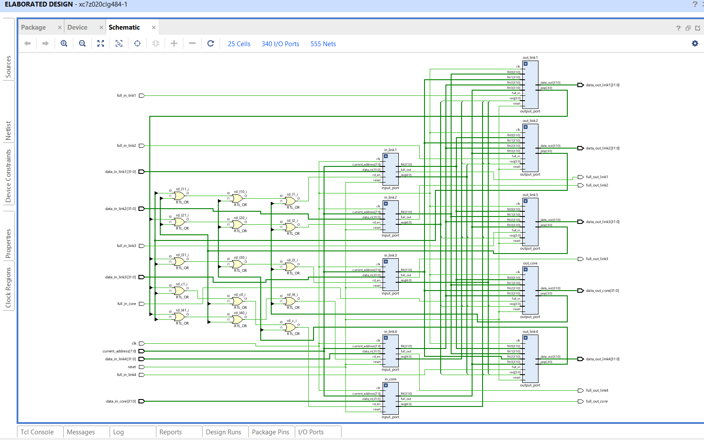
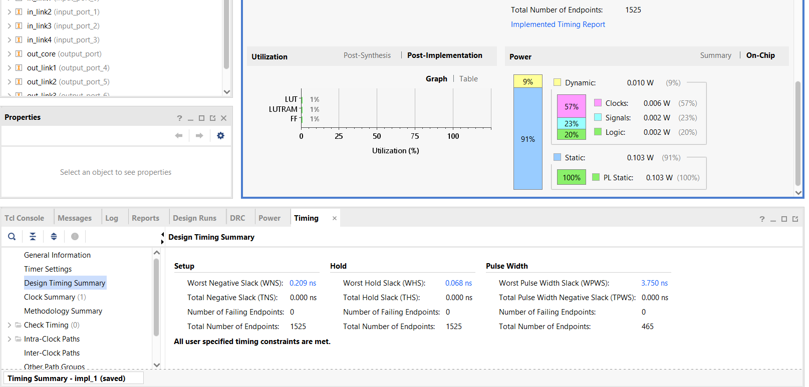

# The golden 5-port router, explained

## What it is

A chip with many processor cores can connect them with a small network, a network-on-chip (NoC). The cores sit in
a grid (a mesh). Each core has its own router, and each router is wired to its neighbours above, below, left and
right. Data travels as packets, cut into 32-bit pieces called flits.

This router has 5 ports: 4 links to neighbouring routers (`link1` to `link4`) and 1 to its own core (`core`).
Each port has an input side and an output side. Every clock cycle, each output can send one flit.

It is a clean rebuild of the router in our MPSoC, with the same pins, the same flit format and the same routing
rule. The one simplification is a single lane per port (the original has 4 virtual channels).

## Words used here

| word | meaning |
|---|---|
| flit | one 32-bit piece of a packet |
| packet | one head flit, any number of body flits, one tail flit |
| wormhole switching | when a packet's head flit wins an output, the whole packet uses that output until its tail flit has passed; other packets wait |
| FIFO | a small queue: the first flit in is the first flit out |
| one-hot | a group of wires where at most one is 1; the 1 marks the choice |
| round-robin | taking turns: whoever was served last goes to the back of the line |
| combinational | logic without memory; its output follows its inputs straight away |
| sequential | logic with flip-flops; it changes only at a clock edge |
| full flag | a signal meaning "my buffer is nearly full, stop sending" |

## The flit (32 bits)

| bits | meaning |
|---|---|
| 31 | not used by the router, passed through |
| 30:29 | flit type: `01` head, `00` body, `10` tail, `11` no flit (idle) |
| 28:27 | virtual-channel number in the original; passed through |
| 26:8 | payload |
| 7:4 | head flit: destination row (other flits: payload) |
| 3:0 | head flit: destination column (other flits: payload) |

When an output has nothing to send it shows the idle flit `32'h6000_0000` (type `11`). Any flit of type `11`
that arrives at an input is ignored.

## The block diagram



Vivado's elaborated schematic (RTL view, before synthesis): 25 cells, 340 I/O ports, 555 nets. Read it from left
to right:

1. **Input pins (left edge):** the 5 incoming flit buses `data_in_*`, the 5 `full_in_*` flags from the next
   routers, and `clk`, `reset`, `current_address`.
2. **15 OR gates (`RTL_OR`, named `rd_l1`, `rd_c` ...):** an input's waiting flit can be taken by any of the 4
   outputs it may go to. The OR gates merge those 4 "taken" signals into one read signal per input:
   3 two-input OR gates per input, 5 inputs, 15 gates.
3. **5 `input_port` blocks (middle):** `in_link1`, `in_link2`, `in_link3`, `in_link4`, `in_core`. Each stores the
   flits arriving on its port and says which output its next flit wants.
4. **5 `output_port` blocks (right):** `out_link1`, `out_link2`, `out_link3`, `out_link4`, `out_core`. Each picks
   one input at a time and sends that input's flits out.
5. **Output pins (right edge):** the 5 outgoing flit buses `data_out_*` and the 5 `full_out_*` flags.

The wires in between carry three things:
- every input port's waiting flit (`flit[31:0]`) and wish (`req[4:0]`) to the 4 output ports it may use;
- every output port's "taken" signals (`pop[3:0]`) back to the OR gates;
- `clk`, `reset` and `current_address` to every block.

## Pins of `router_5port` (340 in total)

| pin | width | direction | meaning |
|---|---|---|---|
| `clk` | 1 | in | clock; everything changes on its rising edge |
| `reset` | 1 | in | while 1 at a clock edge, empties every buffer and frees every output |
| `current_address` | 8 | in | this router's place in the mesh: row in bits 7:4, column in bits 3:0 |
| `data_in_link1` ... `data_in_link4`, `data_in_core` | 5 x 32 | in | flits arriving from each neighbour and from the core |
| `full_in_link1` ... `full_in_link4`, `full_in_core` | 5 x 1 | in | 1 = the receiver behind that output is nearly full: do not send |
| `data_out_link1` ... `data_out_link4`, `data_out_core` | 5 x 32 | out | flits leaving on each port (idle flit when nothing) |
| `full_out_link1` ... `full_out_link4`, `full_out_core` | 5 x 1 | out | 1 = this router's buffer on that input is nearly full: the sender must stop |

Where each port leads:
- `link1` goes to the next higher row;
- `link2` goes to the next lower row;
- `link3` goes to the next higher column;
- `link4` goes to the next lower column;
- `core` goes to this router's own core.

## The 7 modules

```
router_5port                      the whole router (top)
  input_port  x5                  in_link1, in_link2, in_link3, in_link4, in_core
    fifo                          the buffer
    route_compute                 the routing decision
  output_port x5                  out_link1, out_link2, out_link3, out_link4, out_core
    rr_arbiter                    who goes next
    flit_mux                      picks the chosen input's flit
  15 OR gates                     one read signal per input
```

### `fifo`: the buffer of one input (sequential)

| port | width | direction | meaning |
|---|---|---|---|
| `clk`, `reset` | 1 each | in | clock, reset |
| `wr_en`, `din` | 1, 32 | in | store `din` at this clock edge |
| `rd_en` | 1 | in | remove the oldest flit at this clock edge |
| `dout` | 32 | out | the oldest flit, shown without waiting |
| `empty` | 1 | out | nothing stored |
| `almost_full` | 1 | out | 3 or 4 flits stored |

- Holds up to 4 flits.
- A write when 4 are stored is ignored, and so is a read when it is empty.
- In Vivado the 4 x 32-bit storage becomes LUT RAM: the 110 "LUT as Memory" cells come from the 5 buffers.

### `route_compute`: which way to go (combinational)

| port | width | direction | meaning |
|---|---|---|---|
| `flit` | 32 | in | the flit to route |
| `current_address` | 8 | in | this router's row and column |
| `req` | 5 | out | one-hot: bit 0 link1, 1 link2, 2 link3, 3 link4, 4 core; 0 if the flit is not a head flit |

The rule is row first, then column:
1. If the destination row is higher than this router's row, go to link1; if it is lower, go to link2.
2. If the row is the same, compare columns: higher goes to link3, lower to link4.
3. If the column is the same too, the packet has arrived: send it to the core.

This is the original's `routing_algo_mesh`; Yosys proves the two equal for every possible input.

### `rr_arbiter`: whose turn it is (sequential + combinational)

| port | width | direction | meaning |
|---|---|---|---|
| `clk`, `reset` | 1 each | in | clock, reset |
| `req` | 4 | in | which of 4 inputs want this output |
| `advance` | 1 | in | the grant was used this cycle |
| `gnt` | 4 | out | one-hot: the input that may go; 0 if nobody asks |

- Remembers the last winner. Next time, the input after it gets the first chance, so nobody waits forever.
- After reset, input 0 has the first chance.
- The memory moves only when `advance` is 1, that is, when the grant was really used.

### `flit_mux`: pick one flit of four (combinational)

| port | width | direction | meaning |
|---|---|---|---|
| `sel` | 4 | in | one-hot choice |
| `in0` ... `in3` | 4 x 32 | in | the 4 candidate flits |
| `out` | 32 | out | the chosen flit; the idle flit if `sel` is not exactly one 1 |

### `input_port`: one input of the router (fifo + route_compute + route memory)

| port | width | direction | meaning |
|---|---|---|---|
| `clk`, `reset` | 1 each | in | clock, reset |
| `data_in` | 32 | in | flits arriving on this port |
| `current_address` | 8 | in | this router's address |
| `rd_en` | 1 | in | an output took the waiting flit this cycle |
| `full_out` | 1 | out | buffer nearly full (3 of 4): the sender must stop |
| `flit` | 32 | out | the waiting flit (the oldest in the buffer) |
| `req` | 5 | out | one-hot: the output that flit wants; 0 when the buffer is empty |

- Stores every arriving flit that is not idle.
- For a head flit, `req` comes from `route_compute`.
- Body and tail flits carry no address, so the port remembers the route of the head flit when the head leaves,
  and uses it for the rest of the packet.

### `output_port`: one output of the router (rr_arbiter + flit_mux + owner + output register)

| port | width | direction | meaning |
|---|---|---|---|
| `clk`, `reset` | 1 each | in | clock, reset |
| `req` | 4 | in | bit i: input i has a flit for this output |
| `flit0` ... `flit3` | 4 x 32 | in | the waiting flits of those 4 inputs |
| `full_in` | 1 | in | the receiver behind this output is nearly full |
| `data_out` | 32 | out | the flit leaving (from a register) |
| `pop` | 4 | out | one-hot: the input whose flit leaves this cycle |

- **Output free:** the arbiter picks one of the inputs that ask. That input becomes the owner.
- **Output owned:** only the owner may send, until its tail flit has left. Then the output is free again.
- **Each cycle:** if the owner (or the new winner) has a flit and `full_in` is 0, the flit is loaded into
  `data_out` at the clock edge and `pop` tells that input to remove it. Otherwise `data_out` shows the idle flit.

### `router_5port`: the wiring (top)

Each output serves the 4 other inputs, always in this order:

| output | requester 0 | requester 1 | requester 2 | requester 3 |
|---|---|---|---|---|
| `out_link1` | link2 | link3 | link4 | core |
| `out_link2` | link1 | link3 | link4 | core |
| `out_link3` | link1 | link2 | link4 | core |
| `out_link4` | link1 | link2 | link3 | core |
| `out_core` | link1 | link2 | link3 | link4 |

An output never serves its own input, so a packet never goes back where it came from. In a mesh with row-first
routing this never happens anyway; the request bits for it are left unconnected. An input's read signal is the
OR of the 4 `pop` bits that point at it (the 15 OR gates).

## A packet's journey

Take the router at address `8'h11` (row 1, column 1). Its core sends a 3-flit packet to row 2, column 1.

1. **Edge 1:** the head flit (type `01`, destination `8'h21`) is on `data_in_core`. It is written into
   `in_core`'s buffer.
2. **During the next cycle:** the head flit is the oldest flit in that buffer. `route_compute` sees row 2 > row 1
   and asks for `link1`. If `out_link1` is free, its arbiter grants the core.
3. **Edge 2:** if `full_in_link1` is 0, the head flit moves into `data_out_link1`'s register. `in_core` removes it
   and remembers the route `link1`. The core now owns `out_link1`.
4. **Following edges:** the body flit and the tail flit follow the same way. Other inputs that want `link1` wait.
   When the tail flit has left, `out_link1` is free again.

A flit crosses the router in 2 clock edges: one into the buffer, one into the output register.

## Not sending too much

- An input raises `full_out` when 3 of its 4 places are used, not 4. The sender sees the flag one cycle late and
  may already have 2 flits on the way, so the router keeps room for them.
- An output never sends while its `full_in` is 1.
- Together these rules mean no flit is ever lost, which the router and mesh testbenches check.

## Vivado results (ZedBoard, 100 MHz)



Screenshot of the GUI run; the same numbers come from the batch run in `../reports/VIVADO_GOLDEN.md`.

- **Size:** 716 LUTs (110 of them used as memory for the buffers) and 245 flip-flops: about 1% of the chip. No
  latches, no block RAM, no DSP.
- **Timing:** the clock is 10 ns (100 MHz). The worst path has 0.209 ns to spare (fmax 102.1 MHz). Hold
  timing is met too, and all 1,525 timed endpoints pass. That worst path does a lot in one cycle: read a buffer,
  route, arbitrate, and tell the buffer to remove the flit.
- **Power:** 0.113 W in total.
  - 0.103 W is static: the chip's leakage, the same for any design on this chip.
  - 0.010 W is dynamic, caused by the design: clocks 0.006 W, signals 0.002 W, logic 0.002 W.
  - Compare designs on dynamic power.
- **Checks:** no combinational loops, no unconstrained endpoints, no methodology warnings. The 2 DRC warnings
  (outputs with no load, no Zynq processor block) are normal when the router is built on its own.

## What changed from the original

| | original `top_module` (MPSoC) | golden `router_5port` |
|---|---|---|
| virtual channels per port | 4 | 1 |
| clocks | one clock, plus many internal signals used as clocks | one clock |
| storage | flip-flops and 1,744 latches (2x2 mesh) | flip-flops and LUT RAM only |
| combinational loops | 2,202 (2x2 mesh) | 0 |
| timing in Vivado | not analysable (no clock constraint) | met at 100 MHz |
| pins, flit format, routing rule, flow control | as designed | the same |
| modules | 34 in the 2x2 mesh (earlier study's count) | 7 |

The original's figures are for its whole 2x2 mesh on the board (`../reports/ORIGINAL.md`).
