# reSTITCH: the complete record of the journal extension

**What this is.** The whole story of the reSTITCHing work in one place, from the conference paper (STITCH, MLCAD '26)
to the journal paper, `paper/main.tex` (v11, 14 pages). It covers:
- the motivation, every study, and every decision with its reason;
- what replication retired, and what was corrected, with the before and after numbers;
- every figure of the paper, and every table and figure that used to sit in the Supplementary Material;
- what it cost, and what we learned.

It assumes no prior familiarity with the project. Read it top to bottom. **The paper has no supplement any more:** it
states everything it claims, and this document holds the detail behind it (Part 15 is the former supplement, table
by table).

**Companion documents.**
- `paper/V11_CHANGES.md`: how the v11 narrative was drafted, and everything that changed from v10.
- `docs/PHASES_EXPLAINED.md`: each phase in a fixed format (question, design, runs, results, evidence).
- `docs/reSTITCH_REVISITED_QA.md`: questions and answers (written against v10; see its header note).
- `docs/HPC_GUIDE.md`: the cluster procedure.
- `REPO_INDEX.md`: where every file lives and how to regenerate every number.

Every number here appears in the paper or in an evidence file named next to it. Figures are in `docs/figures/`,
regenerated by `python -B paper/make_figures.py`.

---

## Names: the paper's words and the repository's words

The paper (v11) uses readable names; the code, logs and evidence files keep the original ones.

**Feedback conditions** (what is fed back to the model after a failing iteration):

| In the paper | In the repository | Fed back, besides the simulation log | Colour in figures |
|---|---|---|---|
| Baseline | `baseline` | nothing (the AutoChip loop) | grey |
| Alarm | `baseline_gate` | a fixed message: "the design simulates correctly but fails synthesis sign-off" | amber |
| Raw | `raw_adv` | the raw Verilator and Yosys text | vermillion |
| Interpret (v2 or v3) | `sem_adv`; in Phase 3 `sem_adv_v2`, `sem_adv_v3` | raw text plus the interpreter's directives, on every iteration | light blue (v2), dark blue (v3) |
| Escalate | `sem_escalate` | nothing until the run is stuck, then what Interpret feeds back | light green |
| Escalate-R | `sem_escalate_restart`; in Phase 3 `sem_esc_restart_v3` | as Escalate, plus one blank-slate restart if still stuck | dark green |

**Studies** (the paper names studies by what they ask; the repository by run set and phase):

| In the paper | In the repository | Models | Runs |
|---|---|---|---|
| In-house replication (Section 5) | Phase 0 and Phase 1 | Gemma 3 4B, Llama 3.1 8B | 255-run benchmark plus the illustration hunt |
| Tiering and fine-tuning study (Sections 6.1, 6.5) | Set 2, "the Twin" | Gemma 3 4B, Llama 3.1 8B, DeepSeek-Coder 6.7B, RTLCoder 6.7B (two prompts) | 630 |
| Small open models (Section 6.2) | Set 1 | Gemma 3 4B, Llama 3.1 8B, DeepSeek-Coder 6.7B | 1,512 |
| Larger open models (Section 6.3) | Set 3 | Qwen2.5-Coder 14B and 32B, Gemma 3 27B | 612 |
| Commercial models, recoverable tier (Section 6.3) | Set 4 | GPT-4.1 mini, Gemini 2.5 Flash, Claude Haiku 4.5 | 612 |
| Commercial models, floor tier (Section 6.4) | Set 4b | the same three | 599 valid |
| MPSoC case study (Section 7) | Phase 3 (and the API ladder rows, `phase2/frontier/p3_api/`) | 7 open models and the 3 commercial ones | 1,386 + 594 |

**Models** (Ollama tag in the logs, name in the paper): `llama3.2:3b` Llama 3.2 3B; `gemma3:4b` Gemma 3 4B;
`deepseek-coder:6.7b` DeepSeek-Coder 6.7B; `rtlcoder-deepseek-v1.1` RTLCoder 6.7B; `qwen2.5-coder:7b`
Qwen2.5-Coder 7B; `llama3.1:8b` (also `llama3.1`, `llama3.1:latest`) Llama 3.1 8B; `qwen2.5-coder:14b`
Qwen2.5-Coder 14B; `gemma3:27b` Gemma 3 27B; `qwen2.5-coder:32b` Qwen2.5-Coder 32B; `gpt-4.1-mini-2025-04-14`
GPT-4.1 mini; `gemini-2.5-flash` Gemini 2.5 Flash; `claude-haiku-4-5-20251001` Claude Haiku 4.5.

**Metrics** (Phase 3): *sign-off clean* = the sign-off testbench passes and the design is structurally clean;
*signed off defective* = the loop testbench passes but the design is not sign-off clean; *loop-clean*
(`clean_pass` in the code) = the loop testbench passes and the design is structurally clean.

---

## Part 0. The problem and the vocabulary

Hardware is described in code. **RTL** (register-transfer level) is a description of what a circuit does at each clock
tick, written in a hardware description language such as **Verilog**. A synthesis tool turns RTL into gates.

Large language models can write Verilog from an English specification, but they make mistakes. The standard remedy is
a **repair loop**:
1. ask the model for RTL;
2. simulate it against a **testbench** (a program that drives inputs and checks outputs);
3. if it fails, feed the failure back and ask again, up to a fixed number of iterations.

**AutoChip** established that such a loop works.

**Simulation is not sign-off.** A simulator only sees what the testbench drives. Before a block goes to physical
design, it must also pass lint and logic synthesis, and static timing analysis must close it. Some defects simulate
correctly and still break the real design:
- **inferred latches**: accidental memory, created when a combinational block leaves a signal unassigned on some
  path. A latch's enable is decoded by combinational logic, so a glitch can open it and capture a wrong value; timing
  analysis must time paths through a level-sensitive element nobody intended, so the block can fail timing even
  though it simulates perfectly; and test insertion cannot scan it like a flip-flop;
- **multi-driven nets**: two pieces of logic driving one wire;
- **resets a synthesis tool cannot map**: they simulate as intended and abort synthesis;
- **width mismatches** that silently drop the high bits of a bus.

They are caught by two other kinds of tool:
- **lint**, here Verilator, which reads the code for suspicious patterns;
- **synthesis**, here Yosys, which builds the gates and reports latches, loops and unmappable constructs.

**The motivating example of the paper (Figure 1).** The next-PC multiplexer `MuxPC` of the hand-written RISC-V core
(Part 10) selects among three sources; the fourth select value "does not occur in operation", so the `case` has no
default and the testbench never applies it. The module passes its testbench. Verilator reports
`%Warning-CASEINCOMPLETE ... (example pattern 0x3)`, and Yosys reports `Latch inferred for signal
\MuxPC.\input_to_ifu` and builds 32 latch cells (`$_DLATCH_N_ 32`). The real tool logs are frozen in
`phase3/tests/fixtures/real/mpsoc_MuxPC/` (Verilator 5.020, Yosys 0.33); the 32 cells are also in
`phase3/evidence/task_validation.json`. The interpreter's directive for it (v2 text, reproduced by v3):

```
*** YOSYS: LATCH INFERRED for signal(s) 'input_to_ifu' ***
ROOT CAUSE: Yosys inferred a latch on 'input_to_ifu' because it is not
assigned on every code path through the always block. ...
EXACT FIX:
  Add a default branch to the case that assigns 'input_to_ifu':
      default: input_to_ifu = <safe value>;   <-- ADD THIS
```

**STITCH** (the conference paper) adds Verilator and Yosys to the loop. It also places a deterministic
**interpreter** between the tools and the model: a fixed rule set that turns a raw message into a short, specific
repair **directive**. The interpreter calls no model, so it adds no inference cost.

**The interpreter's rule classes** (paper Table 1). v2 is the production interpreter
(`src/interpreter/stitch_interpreter.py`), unchanged since Phase 2; v3 (`stitch_interpreter_v3.py`) is an additive
layer written during Phase 3 that reproduces v2 byte for byte wherever none of its new rules applies.

| Class | Source | Directive, in short |
|---|---|---|
| `UNUSEDSIGNAL` | Verilator | a declared input is never read: use it (e.g. gate the output on it) |
| `MULTIDRIVEN` | Verilator | a signal has several drivers: keep one |
| `UNDRIVEN` | Verilator | an output is never assigned, or a name is undeclared |
| `WIDTHTRUNC/EXPAND` | Verilator | a width mismatch on an assignment: size the operands |
| `BLKSEQ`, `COMBDLY` | Verilator | blocking or delayed assignment in the wrong block type |
| Latch inferred | Yosys | assign every output on every path of the block |
| Combinational loop | Yosys | break the feedback path |
| `MISSING_CLOCK` (v3) | both | a Yosys latch in a level-sensitive block plus an unused clock: make the block edge-triggered |
| `ASYNC_RESET` (v3) | Yosys | "multiple edge sensitive events" abort: one asynchronous reset, other clears synchronous |
| `WIDTH_EXPR` (v3) | Verilator | a width warning on an expression, which v2 dropped |
| `COMB_LOOP` (v3) | Verilator | a loop Verilator reports (`UNOPTFLAT`) when Yosys reports none |

---

## Part 1. Why an extension was needed

The conference paper described four **outcome regimes** of the interpreter:
- **enabling:** a weak model succeeds only with the directive;
- **protective:** interpretation shields a model from confusing raw text;
- **harmful:** firing the interpreter derails a run that was converging;
- **irrelevant:** a failure no tool can see.

Each was shown by **one module, one model, one run (N=1)**.

**The N=1 problem.** Language models sample. Even at a low temperature (T=0.1), the same prompt can pass on one run
and fail on the next. One run cannot separate a real mechanism from luck. The conference paper's own limitations said
so.

**The discipline adopted for the whole extension**, never broken: no interpreter claim without N of at least 3
replicates, and without a check that the interpreter actually fired in the runs credited to it. That check is the
per-run flag `semantic_fired`. A run can pass without the interpreter ever speaking. Crediting such a pass to the
interpreter would be wrong.

**Why N=3 and not more.**
- At N=3, a unanimous 3/3 or 0/3 differs meaningfully from a split, and a single-run "win" shows up as noise.
- Cost grows linearly with N, and the study ran thousands of runs.

The price is that several per-model effects stay undecided. The paper says so (Section 8).

**How the statistics work** (paper Section 4.2, in one paragraph there). A rate carries a Wilson 95% interval. A
difference between two conditions is computed within each (model, module) cell and averaged over cells. The three
runs of a cell share a model and a module, so they are not independent: the interval comes from resampling whole
cells (a bootstrap) and the p-value from a sign-flip test over cells. A difference is called significant when its 95%
interval excludes zero. Full details: Part 15, I.

---

## Part 2. Phase 0: what replicated, and what replication retired (paper Section 5)

**Two illustrations replicate 3/3.** In `decoder_3to8` and `mux4_oe`, Gemma 3 4B omits a declared gating input on
iteration 1.
- Verilator fires `UNUSEDSIGNAL`, and the directive names the port.
- The model passes in two iterations, where Baseline and Raw fail all six.
- Raw tracks Baseline exactly. That control is what isolates the effect to interpretation rather than to the mere
  presence of the tools.

| Module | Model | Baseline | Raw | Interpret |
|---|---|---|---|---|
| `decoder_3to8` | Gemma 3 4B | fail, 6 | fail, 6 | **pass, 2** |
| `decoder_3to8` | Llama 3.1 8B | pass, 2 | pass, 2 | pass, 2 |
| `mux4_oe` | Gemma 3 4B | fail, 6 | fail, 6 | **pass, 2** |
| `mux4_oe` | Llama 3.1 8B | pass, 4 | pass, 4 | pass, 2 |

(Outcome and iterations used, identical in all three runs; this was Table 2 in v10 and is prose in v11.)

**The input/output reachability asymmetry.** We built the mirror-image defect, a forgotten output, in
`adder_with_overflow` and `fsm_next_state_error`. It never occurred: Gemma 3 4B assigned every declared output
unprompted on iteration 1, so the interpreter correctly had nothing to fire on.
- **Why:** an unassigned output looks visibly unfinished, a local gap the model closes as it writes. An unread input
  looks complete: the code compiles and nothing dangles, and noticing the omission requires reasoning about the whole
  module.
- **The rule this gives:** reachability depends on the tool and on how the model fails, and it must be measured per
  defect class. (The table is in Part 15, B.)

**What replication retired.** Three larger candidates were built to show the mechanism at scale. None survived:
- `datapath_mux_alu`: Llama 3.1 8B passed Interpret in 2 of 3 replicates, with `semantic_fired`=0 in all three. At
  N=1 this would have been an interpreter win; it was sampling variance.
- `instr_decode_unit`: Gemma 3 4B received the correct directive and still failed, falling into a syntax loop the
  interpreter has no vocabulary for. Reaching a defect is not the same as repairing it.
- `alu_with_enable`: too easy after its redesign.

**Decision.** Report the retirements at equal weight with the replications. A boundary defines a mechanism as sharply
as a win.

Evidence: `phase0/evidence/phase0_illustration_hunt_findings.md`, `phase0/illustrations/`.

---

## Part 3. Phase 1: escalation (paper Section 3.1)

**The problem.** Always-on interpretation (Interpret) intervenes even when nothing is wrong yet, which is the
conference's harmful regime.

**The design** (`phase1/escalation_state.py`, unit-tested; paper Figure 4):
1. Start in the baseline state.
2. On each failure, compute a normalised error signature from the first 5 lines of the log.
3. After 2 consecutive failures with the same signature, the run is "demonstrably stuck". Switch permanently to the
   escalated state from the next iteration, which feeds back the tool text and the directives.
4. Escalate-R only: after 3 further same-signature failures, issue one blank-slate prompt that discards the current
   RTL, and stay escalated.

**Budgets.** On RTLLM, Baseline and Interpret were capped at 6 iterations and escalation at 8. The extra headroom let
an escalated run use its directives after the two probe failures. At an equal cap of 6 no conclusion changes; one pass
in each escalation condition moves (Part 15, E). In Phase 3 every condition shared one budget of 6 model calls.

**The guarantee, and its correction.**
- **First stated:** "escalation's worst case is bounded below by baseline", as a structural guarantee.
- **What is true:** until the trigger, an escalation run receives exactly the prompts and feedback a Baseline run
  receives. So **on runs that converge before the trigger, escalation is the baseline policy.** Beyond the trigger it
  diverges, and nothing guarantees it does as well as Baseline from there.
- **What the data then show:** on the small-model recoverable tier, Escalate-R matches Baseline (0.0 points, CI -4.6
  to +4.6), while Escalate trails like always-on interpretation (-4.7, CI -10.7 to 0.0).
- **The correction:** v9 rewrote every place the guarantee appeared.

**Cost on the 255-run in-house benchmark** (17 model-module cells x 5 conditions x N=3; paper Table 3):

| Condition | Tokens per run | Tool calls per run |
|---|---|---|
| Baseline | 4,891 | 0.00 |
| Raw | 5,354 | 2.61 |
| Interpret | 4,883 | 2.37 |
| Escalate | 5,151 | **1.53** |
| Escalate-R | 4,719 | **1.37** |

- Escalation calls Verilator and Yosys 35 to 45% less often.
- **The token axis moves the other way** for Escalate (5,151 against Interpret's 4,883), because escalated runs
  execute extra iterations. **Decision:** every efficiency claim is scoped to tool calls.

**The benchmark-premise collapse.** The in-house benchmark's categories came from single runs. Re-measured at N=3, 4 of
its 5 "real-test" cells and 2 of its 3 "enabling" cells (6 of 8) did not reproduce the behaviour they were defined by.
Single-run benchmark labels can encode noise as structure.

Evidence: `phase1/PHASE1_FINDINGS.md`, `phase1/PHASE1_TASK3_ANALYSIS.md`.

---

## Part 4. Three silent harness defects (paper Section 4.3)

All three were found in the shared runner. Each was verified before and after against golden references.

- **A. No working directory for the simulator.** Testbenches that load data with `$readmemh` could never find their
  file, whatever the logic. Fix: run the simulator in the iteration's directory. It was confirmed not to affect the
  conference benchmark.
- **B. Unclosed code fences.** When a model left a markdown fence open, the opening marker stayed in the extracted
  code: 58 of 659 generated files (8.8%) were corrupted.
- **C. The pass string.** The harness looked for `"PASS"`, while RTLLM testbenches print `"Your Design Passed"`.
  - **How it was found:** a near-trivial module, `counter_12`, scored 0/3.
  - **The damage:** a re-scan found 20 of 64 completed runs (31%) misclassified as failures. Worse, their trajectories
    were corrupted: a run that passed on iteration 1 was told it failed and spent its remaining iterations "fixing"
    correct code.

**The structural fix.** All three were the same fragility: an assumption about a benchmark's output format, buried
in shared code, producing plausible wrong numbers. So every pass or fail decision now goes through one function,
`detect_outcome(log, benchmark)` (`src/interpreter/pass_detection.py`):
- it is backed by a per-benchmark registry;
- the benchmark argument has no default, so an unregistered benchmark fails at import, not silently;
- it was regression-verified against 64 manually adjudicated cells;
- a cluster gate requires 44/44 golden designs to pass.

**Why it matters beyond this project.** A 31% silent misclassification rate is large enough to invert a published
comparison.

Evidence: `docs/archive/IMP_PHASE2_RUNNER_HARDENING_REPORT.md`.

---

## Part 5. The RTLLM study design (paper Sections 4.1 and 6.1)

**Why an external benchmark.** Reviewers ask whether results hold on a benchmark you did not build. RTLLM v2.1 has 50
designs from another group.

**The pool.**
- A compatibility screen kept 44 of 50 designs. One exclusion is a defect in RTLLM's own reference.
- `edge_detect` and `square_wave` were dropped because their testbenches pass outputs stuck at 0. Such a weak oracle
  would reward a model that does nothing.
- That leaves **42 modules**.

**Difficulty tiers, the organising idea.** Think of testing whether a tutor helps students. On trivial questions
everyone passes; on impossible ones everyone fails. The tutor's effect is only visible on medium questions.
- **How a tier is set:** by each module's **maximum** Baseline pass rate across the five model configurations of the
  tiering study:
  - **ceiling:** 6 modules, 80% or more;
  - **recoverable:** 17 modules, 20 to 80%;
  - **floor:** 19 modules, under 20%.
- **How they are used:** computed once and reused by every later study.
- **Why it matters:** pooled over all 42 modules, the four small-model conditions lie within 1.6 points, and any signal
  vanishes.

**Is defining tiers from the tiering study circular?** No:
- the tiers use only Baseline runs, never a STITCH condition;
- they come from a different run (T=0.5) than the ones they organise (T=0.1);
- they are fixed before those runs.

What they do define is where an effect can be measured, not its sign.

**Temperatures.** The tiering study compares models, so one temperature (T=0.5) was matched across its five
configurations. The condition studies compare conditions, at the conference setting (T=0.1). Consequence: the
capability ladder that mixes them (Figure 6a) is ordinal across shades.

**The study map** (paper Table 4): which models ran in which study, on what, under which conditions.

| Model | Tiering and fine-tuning | Small open | Larger open | Commercial | MPSoC |
|---|---|---|---|---|---|
| Llama 3.2 3B | | | | | yes |
| Gemma 3 4B | yes | yes | | | yes |
| DeepSeek-Coder 6.7B | yes | yes | | | yes |
| RTLCoder 6.7B (two prompts) | yes | | | | |
| Qwen2.5-Coder 7B | | | | | yes |
| Llama 3.1 8B | yes | yes | | | yes |
| Qwen2.5-Coder 14B | | | yes | | yes |
| Gemma 3 27B | | | yes | | |
| Qwen2.5-Coder 32B | | | yes | | yes |
| GPT-4.1 mini | | | | yes | yes |
| Gemini 2.5 Flash | | | | yes | yes |
| Claude Haiku 4.5 | | | | yes | yes |
| **Tasks** | 42 RTLLM | 42 RTLLM | 17 recoverable | 17 recoverable, 19 floor | 11 MPSoC |
| **Conditions** | Baseline | Baseline, Interpret, Escalate, Escalate-R | same | same | Baseline, Alarm, Raw, Interpret v2, Interpret v3, Escalate-R |
| **Temperature** | 0.5 | 0.1 | 0.1 | 0.1 | 0.1 |
| **Runs** | 630 | 1,512 | 612 | 1,211 | 1,980 |

---

## Part 6. Does Verilog fine-tuning help? (tiering study; paper Section 6.5)

**The natural experiment.** RTLCoder-Deepseek-v1.1 is DeepSeek-Coder 6.7B fine-tuned on curated Verilog, so the pair
differs only by the fine-tuning.
- RTLCoder ran under both its native stub-completion prompt and the shared harness prompt, so prompt format is
  measured rather than confounded.
- Gemma 3 4B and Llama 3.1 8B were added as ladder context.
- Scale: 630 runs, Baseline only, T=0.5, all completed with zero errors.

**Result: a negative result with a per-class exception.**
- **At the shared prompt,** on the 17 recoverable modules: RTLCoder 21/51 (41.2%), base model 32/51 (62.7%); 0 module
  wins, 13 ties (a difference of at most one pass of three, the N=3 noise floor), 4 losses.
- **At the native prompt:** 29/51 (56.9%); 5 wins, 6 ties, 6 losses.
- **The four losses fail at compilation, every iteration,** for four different reasons:
  1. a submodule that is never defined;
  2. SystemVerilog-only syntax;
  3. a parameter binding;
  4. the module named after RTLLM's folder (`fixed_point_substractor`) instead of the name the specification gives,
     identically under both prompts. That is memorisation overriding the prompt.
- **The exception:** RTLCoder (native) clears every recoverable signal-processing module (9/9, three modules) and the
  recoverable memory module (3/3, `LFSR`), and scores 2/6 on control where DeepSeek-Coder scores 0/6. Across all 42
  modules the native prompt is 9/15 on signal processing and 6/12 on memory.
- **Prompt format alone** is a modest, inconsistent effect: native wins 3 modules, shared 2, 12 tie.

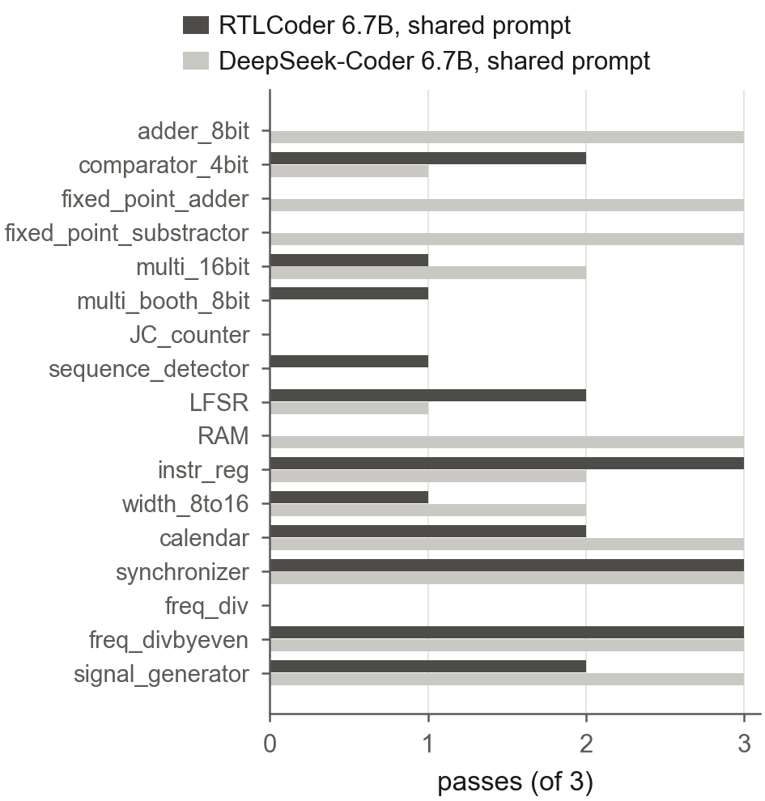
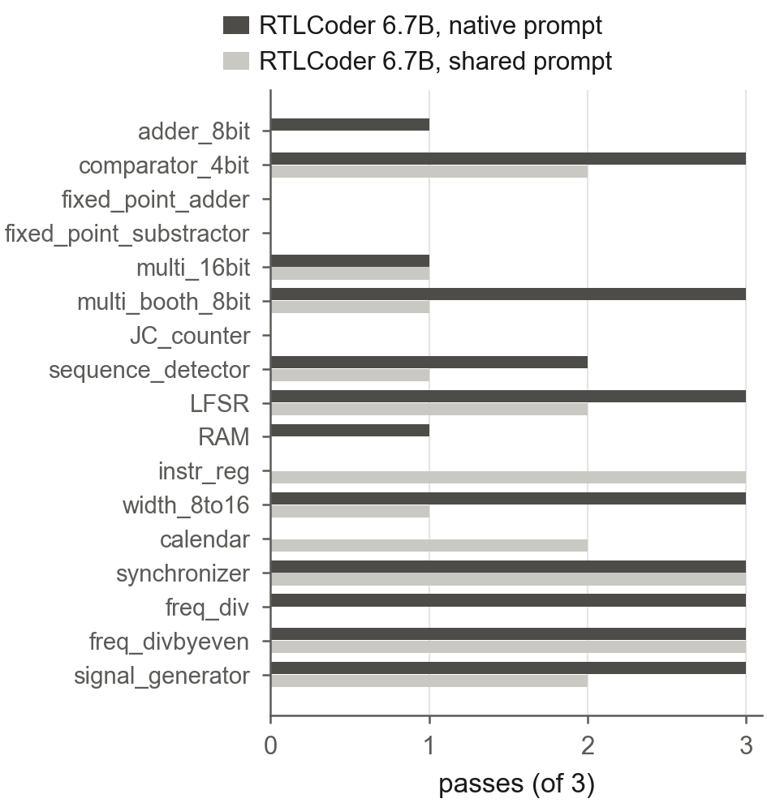

*The tiering study on the 17 recoverable modules, passes of 3, T=0.5. Left: fine-tuning shows no net advantage at the
shared prompt (0 wins, 13 ties, 4 losses: `adder_8bit`, `fixed_point_adder`, `fixed_point_substractor`, `RAM`;
`width_8to16`, 1/3 against 2/3, counts as a tie). Right: prompt format has a modest, inconsistent effect.*

**What it contributes:** the tiers; an external negative result against a published positive claim; the bottom rungs
of the capability ladder.

Evidence: `phase2/TWIN_RUN_ANALYSIS.md`, `phase2/twin_analysis_SET2/module_categories.json`.

---

## Part 7. Small open models (Set 1; paper Section 6.2), and a correction

1,512 runs: Gemma 3 4B, Llama 3.1 8B and DeepSeek-Coder 6.7B, four conditions, 42 modules, T=0.1. Six timeouts, all
transient, were excluded and counted (Part 15, E).

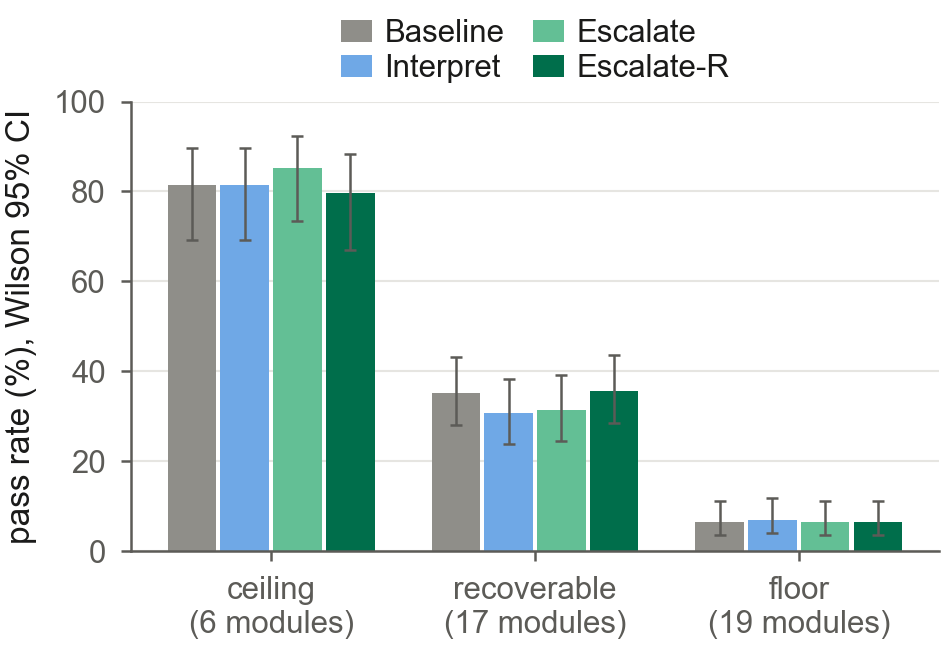
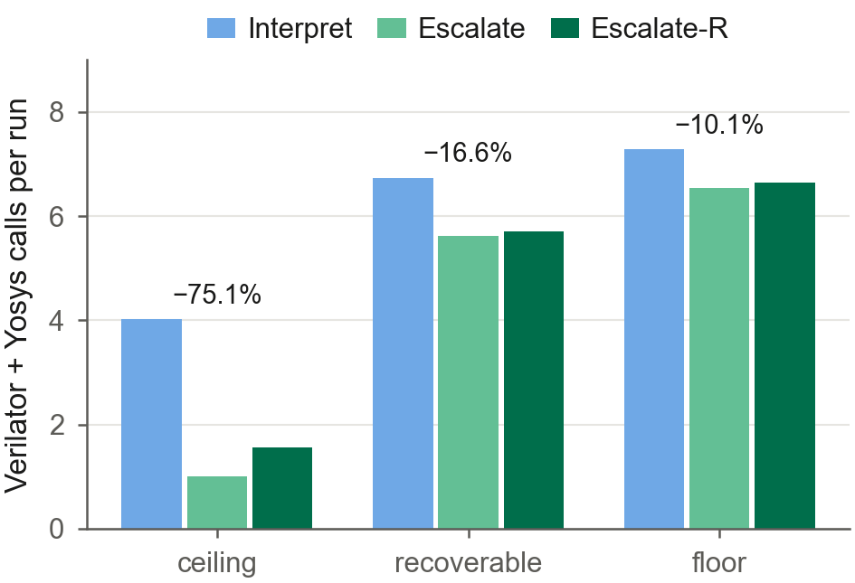

*Paper Figure 5. Left: the conditions differ only on the recoverable tier, and there within noise. Right:
escalation's cut in tool calls against Interpret follows the tier: 75.1% on the ceiling, 16.6% on the recoverable
tier, 10.1% on the floor.*

**First reading:** "the harmful regime replicates at scale". On the recoverable tier, Interpret sits about four points
below Baseline (47/153 against 54/153).

**What the cell bootstrap showed (the final reading):**
- the deficit has CI -10.5 to +0.7 and sign-flip p=0.199: worse in 7 of 51 cells, better in 3, equal in 41;
- it is consistent in direction but not significant;
- it is not uniform across models;
- this study has no Raw condition, so the deficit cannot be separated from the raw tool text that accompanies the
  directives.

The paper therefore says the harmful regime "survives only as a non-significant deficit on small models".

**Escalation.** Escalate-R matches Baseline (54/151 against 54/153; 0.0, CI -4.6 to +4.6). Escalate trails (47/150;
-4.7, CI -10.7 to 0.0).

**Cost by tier.** Escalation's cut in Verilator and Yosys calls against Interpret: 75.1% on ceilings (4.02 to 1.00 per
run), 16.6% on the recoverable tier, 10.1% on floors, 18.5% pooled. On ceilings, 44 of 54 escalation runs passed
before the trigger and made no tool call at all (`phase2/set1_analysis/ceiling_tool_call_distribution.txt`).

---

## Part 8. Larger open models (Set 3; paper Section 6.3), and a retracted reading

612 runs: Qwen2.5-Coder 14B, Qwen2.5-Coder 32B and Gemma 3 27B, four conditions, the 17 recoverable modules. Two
timeouts.

**First reading:** "escalation wins outright on large models". The pooled pass rates were 90/153 for Escalate against
86/153 for Baseline.

**What tracing the replicates showed:**
- of 153 Escalate runs, 88 passed without escalating and 65 escalated;
- the 2 escalated runs that passed had `semantic_fired`=0, rescued by raw tool feedback;
- the lead came from a handful of single-replicate flips, ordinary resampling noise at N=3.

**The final reading:**
- no contrast differs from Baseline (Interpret -0.7, Escalate +2.6, Escalate-R +2.0; all p 0.40 or higher);
- the mean deficit shrinks from -4.6 (small models) to -0.65 points;
- per model it is not monotonic: Gemma 3 27B reverses it (+7.8) and Qwen2.5-Coder 32B keeps it (-5.9), with every
  interval crossing zero.

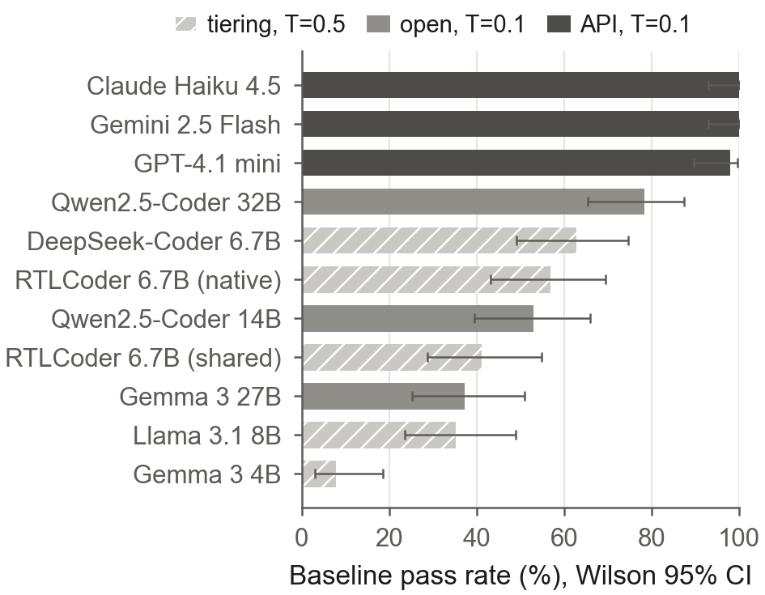
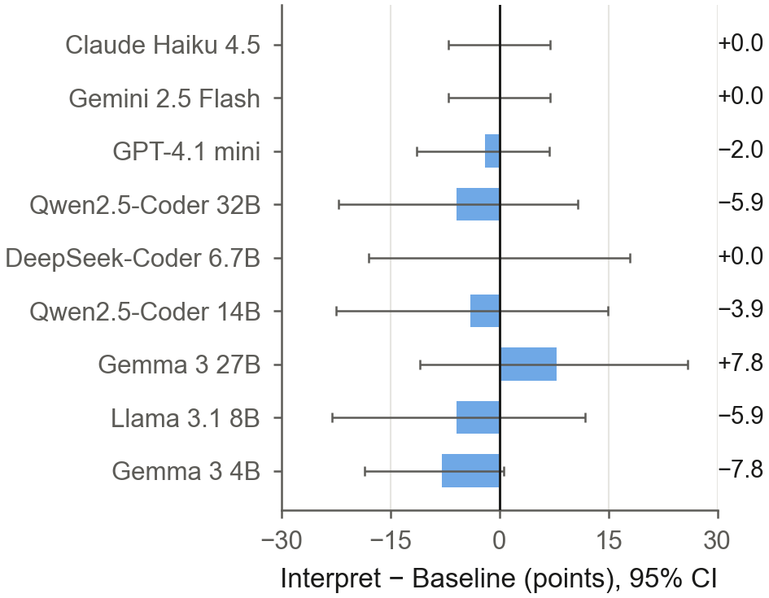

*Paper Figure 6, the capability ladder on the 17 recoverable modules. Left: Baseline pass rate for every model; the
tiering-study bars ran at T=0.5, so the ladder is ordinal across shades. Right: Interpret minus Baseline with Newcombe
intervals for a difference of two proportions: small, not monotonic in model size, every interval crosses zero.*

**Gemma 3 27B, traced.** The reversal sits in `freq_div` and `freq_divbyeven`. The model declares an output port and
then redeclares it as `reg`, which the tools reject. Under Baseline's terse feedback it repeats the same line; under
Interpret's longer, labelled template, with no interpreted directive firing, it finds the fix. Our hypothesis, stated
as a hypothesis: the disposition comes from post-training (instruction tuning), not from model size.

**The cost advantage grows:** 27.6% on the recoverable tier (5.31 to 3.85 calls per run), because capable models get
stuck less often.

---

## Part 9. Commercial models (Sets 4, 4b, 4c; paper Sections 6.3 and 6.4)

**Question.** Do the patterns extend to commercial non-reasoning models, and is the floor beyond the models or beyond
the tools?

**Design.**
- Pre-registered in `phase2/frontier/SET4_PREREG.md`, with dated amendments, each hashed before the calls it governs.
- **Models:** `gpt-4.1-mini-2025-04-14` (pinned snapshot), `gemini-2.5-flash` (thinking budget 0) and
  `claude-haiku-4-5-20251001` (no extended thinking), the most capable non-reasoning model per provider under a cost
  rule.
- **Protocol:** the Set 3 runner with only the model call replaced, at T=0.1, `max_tokens` 8,192. Any reasoning token
  on any call stops the provider; there were none.
- **Toolchain:** oss-cad-suite 20260917 in WSL, matched to the cluster build (Yosys 0.69+71, Verilator 5.053, Icarus
  14.0). On 140 saved Set 3 candidates it reproduces the cluster verdicts exactly (140/140 pass/fail, 51/51
  interpreter outputs).
- **Logging:** every call logs tokens, the returned model version, request and response identifiers and cost;
  truncations: 0.

**Recoverable tier (Set 4, 612 runs).**
- **A ceiling:** pooled pass rates of 99.3, 98.7, 98.0 and 98.0%. Gemini and Haiku pass every run.
- GPT-4.1 mini's three tool conditions trail Baseline by 2.0, 3.9 and 3.9 points, all on one module; no contrast is
  significant (every sign-flip p=1.000).
- **Escalation rarely triggers,** so its tool-call cut reaches 88.6% (2.29 to 0.26 calls per run; 70.5% to 100% per
  model). The trend up the ladder is 16.6 to 27.6 to 88.6%.
- **Cost:** each passing module cost INR 0.11 to 0.51.

**Floor tier (Set 4b, 599 valid runs).**
- 16 of the 19 floor modules leave the floor at Baseline for at least one commercial model, so the floor belongs
  mostly to the 4B to 32B models, not to the modules.
- `adder_pipe_64bit`, `alu` and `freq_divbyfrac` stay at the floor for every model.
- **On the remaining failures, the interpreter fires but credits no pass.** It fires in 55% (103/188) of failing
  tool-condition runs. Only 3 passes followed a directive in a cell whose Baseline was 0/3, and each, traced, is not
  attributable to it. No condition contrast is significant (smallest p=0.062 of 12).

**Claude Haiku 4.5 is incomplete on the floor tier.**
- 143/228 runs: 85 failed on an exhausted account credit (HTTP 400), cost nothing, and are excluded.
- **v11 removed the floor heat map** (v10 Figure 6), because it needed projected values for Haiku's 7 unrun modules.
  The v11 floor paragraph uses measured runs only. The heat map stays here for the record, with its projection:

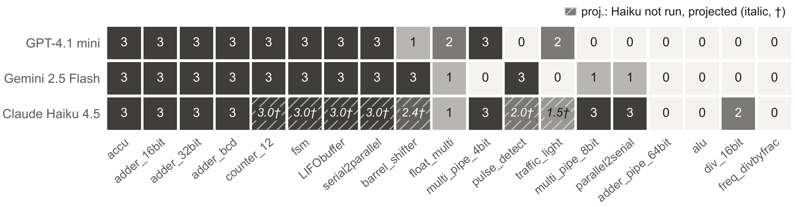

*v10 Figure 6, kept for reference only: Baseline passes of 3 per floor module and commercial model. Hatched, italic
values with a dagger are Haiku projections, not measurements (method in Part 15, F). Most modules the open models could
not pass are passed by at least one commercial model; three stay at the floor for every model.*

- **To bring Haiku back:** run the 85 pending runs (`phase2/frontier/PENDING.md`, section 1), re-run
  `phase2/frontier/analysis_set4b.py` and `make_numbers_set4.py`, and update the floor paragraph of `paper/main.tex`
  (Section 6.4) by hand. A heat map can then return to the paper with measured values only.

**`freq_divbyfrac`, the one module every model fails** (0/36; paper Section 6.4, as a paragraph inside the floor
subsection).
- **What it is:** a divide-by-3.5 clock divider, one of the 19 floor modules, and the only one that all three
  commercial models ran and failed in every run.
- **What the specification says:** the output is high for 3 half clock steps and low for 4, and "the counter cycles
  through 7 half clock steps".
- **What the reference does:** its counter advances once per rising edge, wraps every 14 half steps and emits two
  output periods per wrap.
- **What the candidates do:** none is a phase-shifted copy of the expected waveform. All 34 that compile have roughly
  twice the period.
- **The final statement:** not a testbench defect; the specification's own description of the counter does not match
  its reference design (our reading); and the models fail on period and duty cycle. Full trace: Part 15, G.

**Set 4c (Gemini 2.5 Pro, reasoning).** Its pre-registered stop rule fired on run 1: 10,237 thinking tokens against a
2,048 budget, with the answer cut off. It was closed with 0 of 18 runs and no results.

---

## Part 10. Phase 3: a hand-written RISC-V MPSoC (paper Section 7)

**Why.** RTLLM scores a module by its testbench alone. On the recoverable tier the interpreter had something to say in
only about a third of always-on runs (52 of 153 for the small models). The defects STITCH was built for pass the
testbench, break synthesis, and multiply across a design.

### 10.1 The design, and where it lives

The MPSoC was written by hand within our group for an earlier project, independently of this study, in an FPGA vendor
flow (Vivado). The paper does not name the source; the repository records it in `phase3/designs/SANITISATION.md`.

- **Architecture.** Each node is a five-stage RV32 core with instruction and data memories. A network interface
  (packetiser, depacketiser, asynchronous FIFOs) packs the core's traffic into flits and passes them to a router. The
  routers form a mesh network-on-chip with virtual channels and wormhole switching.
- **Three designs.** A 2x2 mesh (4 routers, top `top_2x2_router`), a 3x3 mesh (9 routers, top `top_3x3_router`),
  which share 28 of their 33 router leaf files, and the processor top (`main`).
- **Folders.**
  - `MPSoC/MPSoC Source Codes/`: the source as received: `main.v`, `processor/` (the core: `MuxPC.v`,
    `Address_select.v`, `mem_wb_mux.v`, `mux3.v`, `execution_unit.v`, ...), `router/` (`register_1bit.v`,
    `register_4bit.v`, `register_32bit.v`, FIFOs, arbiters, ...), `NI/` (flit maker, packetiser).
  - `phase3/designs/mpsoc_ref`, `mesh2x2_ref`, `mesh3x3_ref`: the sanitised designs used for composition.
  - `phase3/tasks/<task>/`: the eleven repair tasks (`spec.md`, `input.v` = defective, `golden.v`, `tb.v` = loop
    testbench, `tb_signoff.v` = sign-off testbench, `meta.json`).
- **Changes made:** compile-level only, each listed in `SANITISATION.md`: line endings and comments; two
  redeclarations in `main.v`; two instantiations with one port fewer than the definition, which Vivado leaves
  unconnected, given an explicit empty trailing connection (identical binding); byte-identical duplicate files kept
  once. **No structural defect was touched**: every latch, the asynchronous-reset abort, the 1-bit PC port and the
  positional miswire are still there.

### 10.2 How hand-written code hides sign-off defects

Module testbenches exercise the intended behaviour, and an FPGA flow that infers a latch reports one warning among
hundreds and carries on. Pushed through Yosys, the MPSoC top reports **63 latch inferences across 12 module
definitions** and then **aborts**. Three patterns recur, each natural to write:

1. **An incomplete `case` or `if` in a combinational block.** `MuxPC` (Part 0) has no default. `mem_wb_mux` assigns
   its store-data output only on some forwarding paths:
   ```verilog
   if (ex_mem_memwrite == 1 && ex_mem_FWD_RS2 == 2'b10)      write_data2 = result;
   else if (ex_mem_memwrite == 1 && ex_mem_FWD_RS2 == 2'b01) write_data2 = result;
   if (ex_mem_memwrite == 1 && ex_mem_FWD_RS2 == 2'b00)      write_data2 = ex_mem_output_data_2;
   ```
   so a latch holds a stale store operand exactly in the cases the testbench never applies.
2. **A register whose `always` block lists control signals instead of the clock edge.** `register_4bit` (and
   `register_32bit`):
   ```verilog
   always @( clr, ce ) begin
     if (clr) dout <= 4'b0000;
     else if (ce) dout <= din;
   end
   ```
   Synthesis builds a level-sensitive latch where a flip-flop was meant. These two definitions are instantiated 20
   times each in every router.
3. **A reset that depends on a synchronous clear.** `register_1bit`:
   ```verilog
   always @(posedge clk, posedge reset)
     if (clr | reset) dout <= 1'b0;
     else if (ce)     dout <= din;
   ```
   It simulates exactly as intended, but Yosys cannot map it (`ERROR: Multiple edge sensitive events found for this
   signal!`) and synthesis of both meshes and the MPSoC top stops.

### 10.3 The defect at scale (paper Figure 7a)

- Each router holds 20 instances of `register_32bit` and 20 of `register_4bit`, which both latch: 36 latched bits per
  pair, so 36 x 20 x 4 = **2,880 latch cells in the 2x2 mesh** and **6,480 in the 3x3 mesh** (abort-causing file
  excluded).
- Yosys prints one message per module definition, so the model sees **the same two messages at both sizes**: the
  feedback does not grow with the damage.
- With the task leaves repaired, both meshes synthesise with **0 latch cells**, and the MPSoC top with **122**, left in
  five modules outside the repair set. For the top, the target is therefore restored synthesis, not a latch-free
  design.
- The top-level testbench executes two instructions and never exercises the network, so top-level claims are
  structural; functional claims rest on the per-module testbenches.

| | 2x2 mesh | 3x3 mesh | MPSoC top |
|---|---|---|---|
| Yosys latch messages, as written | 2 | 2 | 63 |
| Latch cells (abort-causing file excluded) | 2,880 | 6,480 | 269 |
| Top-level synthesis, as written | aborts | aborts | aborts |
| Top-level synthesis, task leaves repaired | pass | pass | pass |
| Latch cells, task leaves repaired | 0 | 0 | 122 |

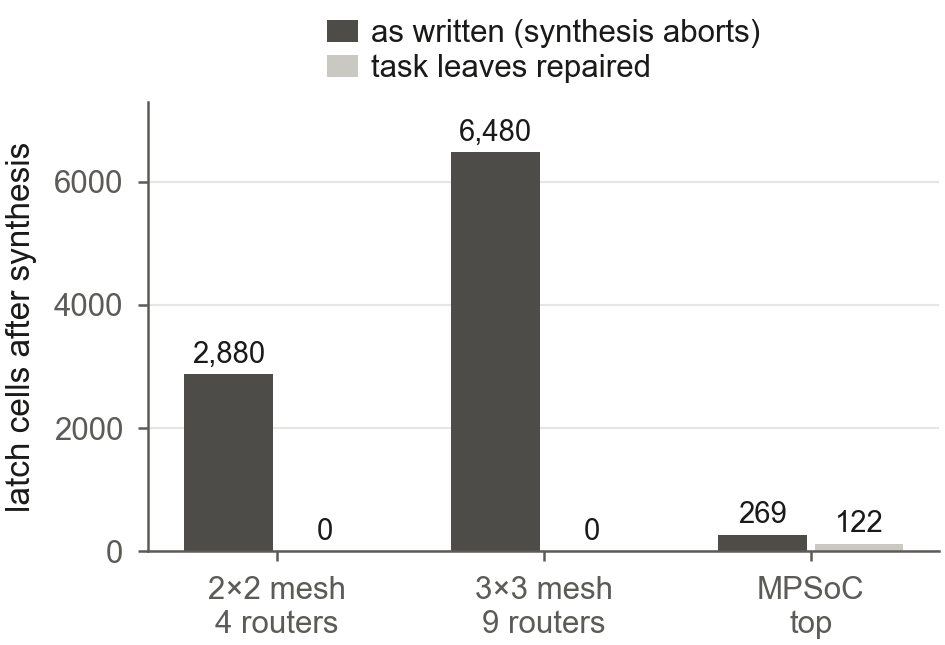
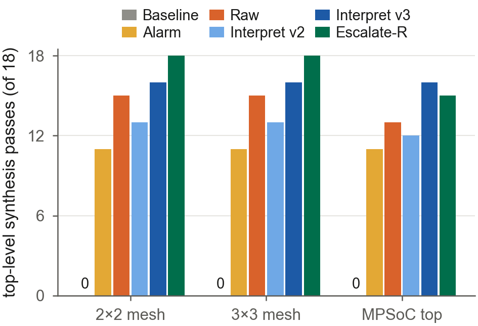

*Paper Figure 7. Left: latch cells grow with the router count while Yosys prints the same two messages. Right: each
condition's repaired leaves spliced back in (18 attempts per design: six models x three runs). Simulation-only repair
never restores synthesis, because it never touches the simulation-silent register that aborts it.*

Evidence: `phase3/evidence/compose_bounds.jsonl`, `phase3/evidence/phase3_run/PHASE3_RESULTS.md` (T7).

### 10.4 v3: keeping the interpreter honest on real logs

Running the production interpreter (v2) on the real logs (`phase3/evidence/PROD_V2_ON_REAL_LOGS.md`, findings F1 to
F10) exposed three kinds of wrong advice and three silences:
- **wrong advice:** an unused clock got the gating template (`if (clk)` in a combinational block, which builds a
  clock-gated latch); a legitimately part-unused instruction bus was turned into "gate the output on this bus"; one
  file holding several modules produced advice for the wrong module;
- **silences:** the asynchronous-reset abort names no signal; a truncation whose operand is an expression was
  dropped; a loop only Verilator reports never reached the model.

The v3 layer (`src/interpreter/stitch_interpreter_v3.py`, version 3.0.1 in every Phase 3 run) imports v2 unchanged
(`interpret(..., version="v2")` reproduces v2 byte for byte, and tests enforce it), caps its output at three
directives, suppresses the gating template on clock ports and on partially used buses, routes advice to the right
module in multi-module files, and adds `MISSING_CLOCK`, `ASYNC_RESET`, `WIDTH_EXPR` and `COMB_LOOP`. A live drift gate
runs the interpreter on fresh tool output before any GPU time; it caught a latch-message format change between Yosys
0.33 and 0.69 that would otherwise have silently disabled the new rules.

### 10.5 The experiment (paper Section 7.2)

**Eleven tasks** (paper Table 5): eight real defective leaves and three seeded ones for classes the design lacks. Six
are simulation-silent: the defective input already passes its loop testbench.

| Task | Role in the design | Defect, as written | Origin | Loop testbench | Stricter sign-off |
|---|---|---|---|---|---|
| `MuxPC` | next-PC select | latch (incomplete `case`) | real | passes it | |
| `execute_mux` | ALU or multiplier result | latch | real | passes it | |
| `mux3` | operand forwarding | latch | real | passes it | |
| `mem_wb_mux` | store-data forwarding | latch | real | passes it | yes |
| `register_1bit` | router state bit | unmappable asynchronous reset | real | passes it | |
| `riscv_alu_flags` | ALU with status flags | latch on the flags | seeded | passes it | |
| `Address_select` | jump target, PC source | latch, 1-bit `PC` port | real | fails it | yes |
| `register_32bit` | router pipeline register | missing clock edge (latch) | real | fails it | |
| `register_4bit` | router channel state | missing clock edge (latch) | real | fails it | |
| `noc_xbar4` | router crossbar port | multi-driven output | seeded | fails it | |
| `ni_flit_pack` | flit packer | width truncation | seeded | fails it | |

- **Specifications are purely behavioural:** a pilot with hints let an 8B model fix everything on the first call
  under every condition, so the hints were removed.
- **Conditions:** all share 6 model calls, one prompt and identically filtered raw text; every candidate is fully
  evaluated. Baseline stops at the first simulation pass, as AutoChip does, so on a simulation-silent task it stops at
  the input (0 model calls). That is not a straw man: it is exactly what a simulation-only loop does. The
  like-for-like comparison is the simulation-visible stratum. Every other condition stops at its first loop-clean
  pass.
- **Runs:** six models from 3B to 14B, N=3, T=0.1, 990 runs on the cluster (five conditions), then the final batch
  (Alarm for the six models, and Qwen2.5-Coder 32B under all six conditions): 1,386 cluster runs. The three commercial
  models ran all six conditions (198 runs each) as ladder rows.

**The equivalence audit, and the sign-off oracle.**
- **The audit:** every loop-clean repair of the 990 runs was checked against its golden fix with Yosys formal
  equivalence. Where a candidate was not proven equivalent, the check was repeated with the inputs the specification
  declares illegal mapped to a legal value ("equivalent on legal inputs").
- **Two testbench gaps:** in `mem_wb_mux`, the testbench never drove the cases where a latch holds a stale store
  operand; in `Address_select`, the testbench checks `J_addr` only on a non-flushed jump, though the specification
  defines it on every input.
- **The fix:** a specification-complete **sign-off testbench** that scores the returned RTL offline and never reaches
  the loop. On the other nine tasks it is identical to the loop testbench.
- **Why re-scoring is exact:** the loop never saw the new oracle, so the 990 runs can be re-scored without re-running.
  The paper labels that post hoc.

**The numbers moved** (`phase3/evidence/phase3_final/PLANNER_BRIEF.md`, section 3). Every ordering and direction
survived, and the absolute rates for the tool conditions fell 5 to 8 points, mostly from `Address_select`:

| Claim | As run (loop testbench) | Under the sign-off oracle |
|---|---|---|
| clean rate: Baseline / Raw / v2 / v3 / Escalate-R | 23 / 59 / 68 / 74 / 80% | 22 / 53 / 63 / 67 / 72% |
| Baseline signed off defective | 62% (old "silent structural pass") | 63% (125/198) |
| v3 minus Raw | +14.6 | +14.1 (CI +3.5 to +24.7) |
| v2 minus Raw | +9.1 | +10.1 (CI +2.0 to +18.7) |
| Escalate-R minus Baseline, simulation-visible | +23.3 | +14.4 (CI +3.3 to +27.8) |

We built a stricter oracle, applied it to our own results, and reported every number it lowered.

**The control arm: the single most important run.**
- **The worry:** Escalate-R opens with a generic message ("the design simulates correctly but fails synthesis
  sign-off"). Its advantage might come from that alarm alone, not from the interpreter's detail.
- **The test:** Alarm gives simulation plus exactly that message, never escalates, and logs (never feeds back) what
  v3 would have said.
- **How it was run:** pre-registered before any of its runs, together with Qwen2.5-Coder 32B under all six conditions
  (`phase3/evidence/PREREG_FINAL.md`): four primary contrasts and their readings, frozen with the runner, interpreter
  and task files in `FREEZE_FINAL.md`.
- **If the alarm had matched escalation,** the reading would have been that the gain is the stop-on-clean rule plus a
  nudge, and that the interpreter adds nothing measurable. The paper would have had to say so.

### 10.6 Results (paper Section 7.3)

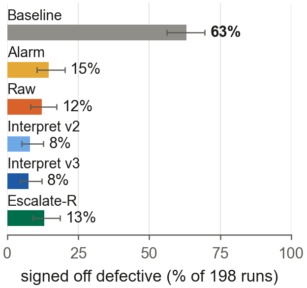
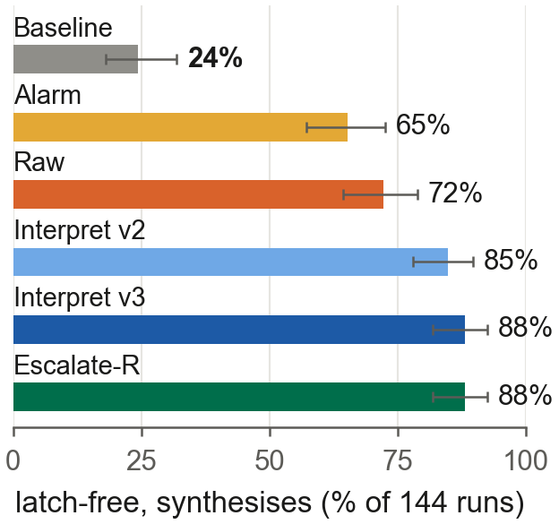
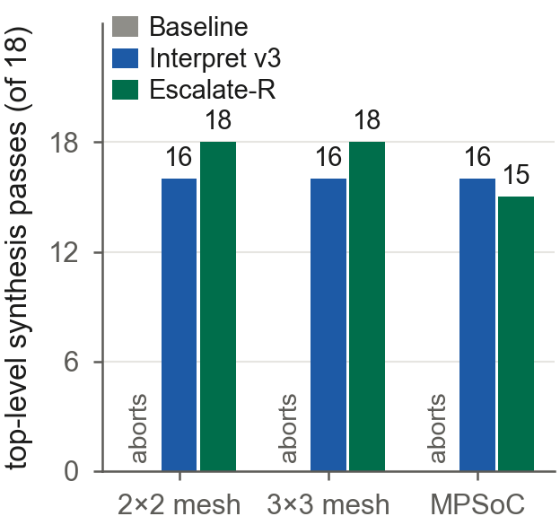

*Paper Figure 2 (the teaser). (a) Simulation-only repair signs off 63% of its runs as defective; with lint and
synthesis in the loop, 8 to 15%. (b) On the eight latch-bearing tasks, runs that end latch-free with a clean synthesis
rise from 24% to 88%. (c) With the repaired modules spliced back, simulation-only repair never yields a design that
synthesises; Interpret v3 and Escalate-R do in 15 to 18 of 18 attempts.*

**By condition** (paper Table 6; six open models, 198 runs each):

| Condition | Sign-off clean % | 95% CI | Signed off defective % | Loop pass % | Calls per run | Tokens per run |
|---|---|---|---|---|---|---|
| Baseline | 22 | 17-28 | 63 | 85 | 1.34 | 1,425 |
| Alarm | 52 | 45-59 | 15 | 67 | 3.39 | 3,835 |
| Raw | 53 | 46-59 | 12 | 65 | 3.27 | 4,396 |
| Interpret v2 | 63 | 56-69 | **8** | 71 | 2.83 | 3,831 |
| Interpret v3 | 67 | 60-73 | **8** | 74 | 2.51 | 3,377 |
| Escalate-R | **72** | 65-78 | 13 | 85 | 2.99 | 3,798 |

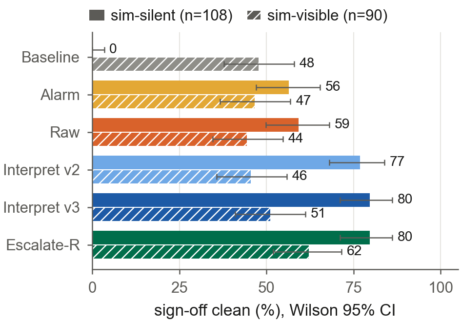
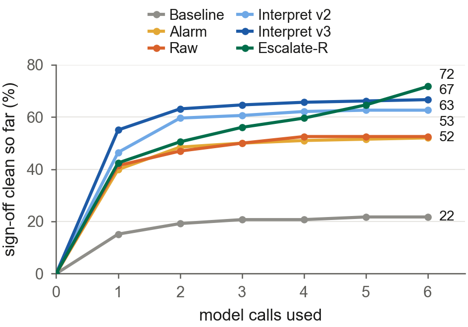

*Paper Figure 8. Left: Baseline scores 0/108 on simulation-silent defects by construction; escalation leads on both
task types. Right: v3 front-loads its repairs, the alarm alone plateaus after the third call, and Escalate-R, which
opens with the same alarm, climbs to the highest final rate.*

**Pre-registered primary contrasts** (paper Table 7; sign-off clean, six models):

| Contrast (A - B) | Tasks | Delta | 95% CI | p | A/B only |
|---|---|---|---|---|---|
| 1. Escalate-R - Alarm | all | +19.7 | +11.1 to +29.3 | <0.001 | 42/3 |
| | simulation-silent | +23.1 | +11.1 to +37.0 | 0.002 | 27/2 |
| | simulation-visible | +15.6 | +4.4 to +27.8 | 0.022 | 15/1 |
| 2. Interpret v3 - Alarm | all | +14.6 | +3.0 to +26.3 | 0.021 | 43/14 |
| | simulation-silent | +23.1 | +6.5 to +39.8 | 0.014 | 31/6 |
| | simulation-visible | +4.4 | -11.1 to +20.0 | 0.688 | 12/8 |
| 3. Alarm - Raw | all | -0.5 | -9.1 to +8.1 | 1.000 | 16/17 |
| | simulation-silent | -2.8 | -13.0 to +7.4 | 0.738 | 6/9 |
| | simulation-visible | +2.2 | -11.1 to +15.6 | 0.882 | 10/8 |
| 4. Alarm - Baseline | simulation-visible | -1.1 | -4.4 to +2.2 | 1.000 | 2/3 |

The pre-registered reading, R1: **the detail in the feedback adds value beyond the verdict.** Multiplicity: the
contrasts are uncorrected by design; under Holm across the four, contrast 1 survives and contrast 2 (adjusted 0.063)
does not.

**The eight results, in short.**
1. **Latches.** Latch-free clean synthesis on the latch-bearing tasks rises from 24% (35/144) to 88% (127/144) under v3
   and escalation; v2 85% (122/144), Raw 72% (104/144), Alarm 65% (94/144). This count uses Yosys only. Baseline passes
   its loop testbench in 85% of runs but is sign-off clean in 22%; 125 of 198 (63%) are signed off defective, all 108
   simulation-silent runs among them.
2. **The alarm alone is not enough.** Alarm 52% sign-off clean, level with Raw (53%). From call 3 to call 6 the alarm
   adds two points (50 to 52%), while escalation climbs from 56 to 72% once it hands over to v3. Of 108
   simulation-silent alarm-only runs, all starting from RTL that simulates, 80 still pass the loop testbench at the end,
   against 97 under escalation: the alarm alone breaks working logic. Of the 95 alarm-only runs that are not sign-off
   clean, 38 returned RTL that still carries a defect v3 names (logged, never fed back). Escalation over the alarm is
   +39.4 on Llama 3.2 3B and +33.3 on Gemma 3 4B (Holm p=0.006 each).
3. **Interpretation beats raw text, sooner and cheaper.** v3 132/198 against Raw 104/198: +14.1 (CI +3.5 to +24.7,
   p=0.014; 40 discordant pairs against 12). v2, written before this study and never tuned on its designs: +10.1 (CI
   +2.0 to +18.7, p=0.030), the honest out-of-sample estimate. v3 needs about 23% fewer calls and tokens (5,066 against
   8,370 tokens per sign-off-clean run); 55% of v3 runs are sign-off clean after the first call, against 41% with raw
   text and 15% with simulation only. Largest on Llama 3.2 3B (+24.2) and Qwen2.5-Coder 7B (+27.3); the 14B model is at
   30/33 with either.
4. **Escalation reaches 72%** with 47.5% fewer tool rounds than always-on v3 and keeps Baseline's 85% loop pass rate.
   On simulation-visible tasks it beats Baseline by +14.4 (56/90 against 43/90). Llama 3.2 3B on those tasks: 7/15
   simulation only, 1/15 raw text every round, 8/15 escalation.
5. **Leaves compose.** Simulation-only repair never restores top-level synthesis. v3 does in 16/18 groups per design,
   escalation in 18/18 for both meshes and 15/18 for the MPSoC top, raw text 15, 15 and 13, the alarm 11/18. Whenever
   all composed leaves were loop-clean, the design reached its bound (32/32, 32/32, 27/27).
6. **Up the ladder** (paper Table 8, below): at 32B and for the three commercial models, any tool feedback repairs
   every simulation-silent defect; simulation-only repair still signs off all 18 simulation-silent runs as defective
   for every model. The pass-rate benefit is a small-model effect; the guard is needed at every size.
7. **The v3 upgrade closes the vocabulary gaps.** Where v2 was silent (`register_1bit`, `ni_flit_pack`), v3 fires in
   18/18; on `register_1bit`, interpreter-credited wins rise from 3/18 to 15/18. On the four tasks singled out before
   the runs, sign-off clean rises from 42/72 to 50/72 (+11.1, CI -9.7 to +31.9), in-sample.
8. **A limitation of structural advice.** 41 loop-clean `Address_select` repairs set `J_addr` to 0 where the
   specification defines `X + PC`, and 16 `mem_wb_mux` repairs drive an unspecified value in the unchecked cases. The
   production latch advice ("one unconditional assignment ... `<safe value>`") appears in every such `Address_select`
   run under v2, v3 and escalation (8, 12, 11), and in none of the 3, 7 and 2 under Baseline, Raw and Alarm: a count,
   not a causal claim. The violation is invisible at processor level, because the consumer reads `J_addr` only on a
   jump.

**Larger and commercial models** (paper Table 8; sign-off clean on the simulation-silent tasks, of 18, and the
simulation-visible tasks, of 15, and tokens per run):

| Condition | Qwen 32B sil. | vis. | tok. | GPT-4.1 mini sil. | vis. | tok. | Haiku 4.5 sil. | vis. | tok. | Gemini 2.5 Flash sil. | vis. | tok. |
|---|---|---|---|---|---|---|---|---|---|---|---|---|
| Baseline | 0 | 12 | 663 | 0 | 12 | 440 | 0 | 12 | 517 | 0 | 15 | 516 |
| Alarm | 16 | 12 | 1,824 | 16 | 12 | 1,529 | 18 | 12 | 1,099 | 18 | 15 | 1,160 |
| Raw | 18 | 12 | 1,492 | 18 | 12 | 1,164 | 18 | 12 | 1,334 | 18 | 12 | 1,291 |
| Interpret v2 | 18 | 12 | 1,655 | 18 | 12 | 1,255 | 18 | 12 | 1,517 | 18 | 15 | 1,478 |
| Interpret v3 | 18 | 12 | 1,660 | 18 | 12 | 1,257 | 18 | 12 | 1,524 | 18 | 14 | 1,479 |
| Escalate-R | 18 | 12 | 1,850 | 18 | 12 | 1,404 | 18 | 12 | 1,101 | 18 | 15 | 1,225 |

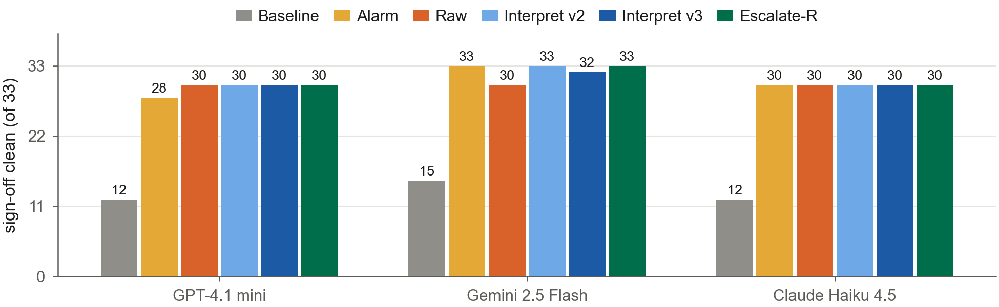

*The three commercial rows, sign-off clean of 33 by condition: simulation alone signs off every simulation-silent
defect; any tool feedback repairs them.*

The detailed Phase 3 tables (per task, per model, the would-fire log, the equivalence audit, the advice count, cost,
composition at the latch bound, sensitivities) are in Part 15, H.

---

## Part 11. How the paper evolved

| Version | What changed, and why |
|---|---|
| Conference (MLCAD '26) | four regimes, N=1 illustrations, in-house benchmark |
| v7 | the extension: replication, escalation, harness, the RTLLM study, Phase 3 as run (loop testbench) |
| v8 | Phase 3 rebuilt on the sign-off oracle; the control arm and 32B added; the API ladder rows; the alarm-versus-detail result as the headline |
| v9 | condensed to 16 pages plus a supplement; the escalation guarantee corrected everywhere; the Gemini column; the `freq_divbyfrac` analysis; bibliography checked against Crossref and arXiv; the deficit figure's intervals correctly labelled Newcombe |
| v10 | Overleaf-ready, self-contained build (15 pages) plus a 14-page supplement; a unified figure style; the teaser figure; the multiplicity note; Haiku's projections marked and removable |
| **v11** | **`paper/main.tex`, 14 pages, no supplement.** Rewritten for a reader who has not read the conference paper: a new motivation (a latch that passes simulation and fails sign-off, from the real MPSoC); claims instead of contribution bullets; readable condition, model and study names; a study map instead of "Set 1 to 4b"; one plain paragraph on the statistics; the MPSoC told as a story; the floor heat map removed (Haiku incomplete); `freq_divbyfrac` as a paragraph inside the floor subsection; a short Availability; the ACM journal look. Details: `paper/V11_CHANGES.md` |

v7 to v10 are in `paper/archive/` (local only, gitignored); v10 is also in git history at commit `e77bf73`
(`paper/overleaf/`).

---

## Part 12. What it cost

**Cluster runs** (Ollama serving on the institutional GPU cluster):

| Study | Runs | Hardware |
|---|---|---|
| Tiering and fine-tuning (Set 2) | 630 | H100 |
| Small open models (Set 1) | 1,512 | A100 |
| Larger open models (Set 3) | 612 | A100 |
| MPSoC, 990-run batch | 990 | H200 NVL |
| MPSoC, final batch | 396 | H200 NVL |
| **Total** | **4,140** | |

- **Excluded:** 8 transient timeouts (6 small-model, 2 larger-model).
- **Wall time:** each run records its own wall time, but no total GPU-hour figure was compiled.

**Laptop runs:** the 255-run in-house benchmark (Phase 1), the Phase 0 hunt, and every API run.

**API spend:** $13.70 (INR 1,552 at USD x 96 x 1.18) over all commercial-model work (Sets 4, 4b and 4c, the MPSoC
ladder rows and the completion runs), counting every paid call, including smoke tests and pilots. By provider:
Anthropic $6.69, Google $4.72, OpenAI $2.29 (`phase2/frontier/evidence/spend_summary.txt`).

---

## Part 13. Lessons

1. **Replicate before you claim.** Two of the conference-era readings ("the harmful regime replicates", "escalation
   wins on large models") did not survive N=3 with a cell-level test and a replicate trace.
2. **Gate every mechanism claim on `semantic_fired`.** A pass is not a win for the interpreter unless the interpreter
   spoke.
3. **Report by difficulty tier.** Pooling ceilings and floors hides any effect.
4. **Put pass detection in one place, with no defaults.** Silent harness bugs produce plausible wrong numbers.
5. **Separate the alarm from the detail.** Without the control arm, escalation's gain could not be attributed to the
   interpreter.
6. **Use an oracle the loop never sees.** A loop testbench is also a training signal. A specification-complete
   sign-off testbench caught repairs that were structurally clean and functionally wrong.
7. **Pre-register and hash.** The final batch and the API study were fixed before their runs, so their readings cannot
   drift after the fact.
8. **Scope efficiency claims to the axis that holds.** Tool calls fall with escalation; tokens can rise.
9. **State limitations as findings.** The `Address_select` advice result became a direction for the next interpreter,
   not something to hide.

---

## Part 14. Directions (paper Section 9)

1. **Held-out real defects,** to test the v3 rules out of sample. They were written from these designs' logs.
2. **A specification-valued latch default:** "assign the value the specification defines", not a constant. This
   targets the `Address_select` violations.
3. **Integration-level feedback,** for defects that only exist once modules are connected: a one-bit program-counter
   port driven with 32 bits; a FIFO instantiated by position with a missing port.
4. **Reasoning models,** and why the deficit depends on post-training rather than size.
5. **Specification-level robustness:** `freq_divbyfrac` shows a specification defect that no interpreter can see.
6. From the MPSoC study: return the best candidate so far (some runs pass simulation at some point and lose it: 23 of
   198 under v3 and 11 under escalation in the 990 runs); more replicates on the flat tasks (`noc_xbar4`,
   `riscv_alu_flags`).

Two commitments carry into any future work:
- every interpreter claim stays N=3-replicated and `semantic_fired`-gated;
- every pass rate is reported against the difficulty tier that decides whether the mechanism could even be measured.

---

## Part 15. The detail behind the paper (formerly Supplementary Material S1 to S9)

v10 had a 14-page supplement. v11 has none: the paper states what it claims, and the detail lives here. The v10
supplement source is in `paper/archive/v10/overleaf/supplement.tex` (local) and in git history.

### A. Interpreter, conditions and escalation (was S1)

**Production interpreter (v2).** `src/interpreter/stitch_interpreter.py`, never edited since Phase 2 (SHA-256 of the
LF-normalised file `42f61a49...2abff`, recorded in every Phase 3 run).

**Verification status of each class** (was Table S1): whether each was verified against real tool output, not only
synthetic strings.

| Class | Source | Verified on real data |
|---|---|---|
| `UNUSEDSIGNAL` | Verilator | yes, two modules and two models (the replicated illustrations); wrong directive on clock ports and on partially used buses (Phase 3) |
| `MULTIDRIVEN` | Verilator | yes, both Verilator 5 message formats; first net only |
| `UNDRIVEN` | Verilator | synthetic plus one real regression case |
| `WIDTHTRUNC`/`WIDTHEXPAND` | Verilator | yes for named operands; silently dropped when the operand is an expression |
| `BLKSEQ` | Verilator | yes; signal extraction yields a prose word on Verilator 5 output |
| `COMBDLY` | Verilator | real Verilator 5 uses the code for `<=` in a combinational block, not a `#` delay; the template assumes the latter |
| Latch inferred | Yosys | yes |
| Combinational loop | Yosys | yes; a loop reported only by Verilator (`UNOPTFLAT`) is missed |
| `MISSING_CLOCK` (v3) | fusion | yes, two MPSoC router registers |
| `ASYNC_RESET` (v3) | Yosys | yes, the one-bit router register that aborts synthesis |
| `COMB_LOOP` (v3) | Verilator | yes, an instruction-fetch loop |
| `WIDTH_EXPR` (v3) | Verilator | yes, the flit packer |
| `PINMISSING` (v3) | Verilator | yes (748 in the MPSoC); composition-level, not a repair task |
| `RESET_UNUSED` (v3) | Verilator | synthetic only |

**Conditions, precisely.** Baseline: simulation log only. Raw: plus the filtered raw Verilator and Yosys lines.
Interpret: plus the interpreter's directives on every iteration. Escalate: starts as Baseline; after N=2 consecutive
failures with the same error signature it escalates permanently to Interpret's feedback. Escalate-R: as Escalate,
plus one blank-slate prompt after M=3 consecutive same-signature failures counted from the first escalated iteration
(the triggering failure is not counted); the streak then resets and the run stays escalated. The signature keys on the
first 5 lines of the normalised log. The state for iteration i is decided from iterations 1 to i-1 only, so the
iteration whose failure triggers escalation still ran under baseline tooling. The state machine is a pure class with
unit tests (`phase1/escalation_state.py`).

### B. Replication details (was S2)

**The reachability check** (was Table S2): forgotten inputs are reachable, forgotten outputs are not (Gemma 3 4B,
hand-built diagnostic modules, not RTLLM).

| Target class | Module | Iteration-1 behaviour | Fired |
|---|---|---|---|
| Forgotten input | `decoder_3to8` | port declared, never read | 1 |
| Forgotten input | `mux4_oe` | `oe` never referenced | 1 |
| Forgotten output | `adder_with_overflow` | output assigned unprompted | 0 |
| Forgotten output | `fsm_next_state_error` | output assigned on all paths | 0 |

On the two enabling cells the interpreter also cuts token cost roughly 5 to 7x against both controls. The survivors
are small, but primitives compose: a forgotten output-enable on a multiplexer instantiated many times in a design is
that many latent defects, and the MPSoC study tests exactly this argument. Several further candidates built to elicit
the gated-input defect were discarded because the specification accidentally handed the model the answer, or because
the defect was a missing default the system prompt already forces. The regression gate held: both replicated
illustrations pass 4/4 on strict pass/fail under the new conditions.

### C. Harness defects (was S3)

Covered in full in Part 4.

### D. RTLLM pool, pilot and the fine-tuning comparison (was S4)

**Pool:** RTLLM v2.1 has 50 designs; a batch compatibility screen found 44 compatible with the Icarus flow, and each of
the 6 exclusions has a documented cause, one of them a defect in RTLLM's own reference. `edge_detect` and
`square_wave` were excluded because their testbenches pass with stuck-at-0 outputs. 42 modules remain.

**Pilot:** a five-module pilot completed three modules before a thermal stop and showed no condition differentiation:
they spanned a ceiling (`counter_12`), a floor (`accu`) and a flat mid-point (`barrel_shifter`), none in the band where
an effect is measurable. Hence the tiers.

The fine-tuning comparison and its figures are in Part 6.

### E. Small and larger open models in detail (was S5)

**Scope and timeouts.** Small models: of 1,512 cells, 6 (0.4%) errored as timeouts and are excluded: five on `RAM`
with Llama 3.1 8B (Escalate replicates 1 to 3, Escalate-R replicates 1 and 3) and one on `LIFObuffer` with
DeepSeek-Coder 6.7B (Escalate-R, replicate 2). `RAM`/Llama 3.1 8B is 0/3 under Baseline and Interpret, so counting the
missing runs as failures moves the recoverable rates to 47/153 (30.7%) and 54/153 (35.3%); no conclusion changes.
Larger models: of 612 cells, 2 (0.3%) errored (Qwen2.5-Coder 32B, one `comparator_4bit` and one `multi_booth_8bit`).

**Iteration budget.** Baseline and Interpret were capped at six iterations, the escalation policies at eight, the
tiering-study Baselines at eight. On the recoverable tier one Escalate and one Escalate-R pass among the small models
arrived only in iterations seven or eight (47/150 becomes 46/150, and 54/151 becomes 53/151, at a cap of six), and none
among the larger models; at an equal cap Escalate-R is 53/151 (35.1%) against Baseline's 54/153 (35.3%).

**Small models, passes by tier and condition** (was Table S3; 3 models, N=3):

| Tier | Modules | Baseline | Interpret | Escalate | Escalate-R |
|---|---|---|---|---|---|
| Ceiling | 6 | 44/54 | 44/54 | 46/54 | 43/54 |
| Recoverable | 17 | 54/153 | 47/153 | 47/150 | 54/151 |
| Floor | 19 | 11/171 | 12/171 | 11/171 | 11/170 |
| Pooled | 42 | 109/378 | 103/378 | 104/375 | 108/375 |
| Pooled, % | | 28.8 | 27.2 | 27.7 | 28.8 |

**Small models, Verilator and Yosys calls per run by tier** (was Table S4), and the cut of Escalate against Interpret:

| Tier | Modules | Interpret | Escalate | Cut, % |
|---|---|---|---|---|
| Ceiling | 6 | 4.02 | 1.00 | 75.1 |
| Recoverable | 17 | 6.74 | 5.62 | 16.6 |
| Floor | 19 | 7.28 | 6.54 | 10.1 |
| Pooled | 42 | 6.60 | 5.38 | 18.5 |

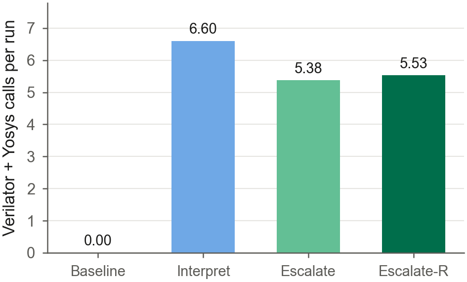
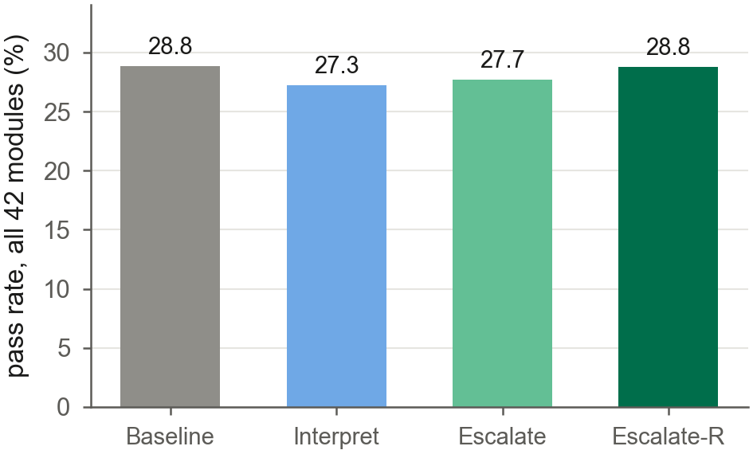

*Small models, 1,512 runs, pooled over all 42 modules. Left: escalation calls Verilator and Yosys less often than
always-on interpretation. Right: the pooled pass rates lie within 1.6 points of each other.*

**Larger models, recoverable tier, pass rate per model** (was Table S5; n=51 per cell, except Qwen2.5-Coder 32B
Escalate-R, n=49):

| Model | Baseline | Interpret | Escalate | Escalate-R |
|---|---|---|---|---|
| Qwen2.5-Coder 14B | 52.9 | 49.0 | 56.9 | 58.8 |
| Gemma 3 27B | 37.3 | 45.1 | 37.3 | 33.3 |
| Qwen2.5-Coder 32B | 78.4 | 72.6 | 82.4 | 83.7 |
| Pooled | 86/153 | 85/153 | 90/153 | 88/151 |
| Pooled, % | 56.2 | 55.6 | 58.8 | 58.3 |

**Replicate trace (larger models).** Of 153 Escalate runs, 88 passed without escalating, 65 escalated, and 2 of those
passed, both with `semantic_fired`=0, rescued by raw Verilator and Yosys feedback within the first six iterations. No
passing Escalate run had the interpreter fire; for Escalate-R one of 88 passing runs did, and seven of Interpret's 85.
The net pooled escalation lead (+4 runs) comes from six cells gaining seven runs in total against three cells losing
one each. Tool calls on the recoverable tier: 5.31 (Interpret) to 3.85 (Escalate) per run, 27.6%.

**Recoverable-tier contrasts against Baseline** (was Table S6; points, (model, module) cell bootstrap 95% CI and
sign-flip p; `phase3/runner/posthoc_checks.py`). None differs from Baseline.

| Study | Condition - Baseline | Passes | Delta | 95% CI | p |
|---|---|---|---|---|---|
| Small | Interpret | 47/153 vs 54/153 | -4.6 | -10.5 to +0.7 | 0.199 |
| Small | Escalate | 47/150 vs 54/153 | -4.7 | -10.7 to +0.0 | 0.148 |
| Small | Escalate-R | 54/151 vs 54/153 | 0.0 | -4.6 to +4.6 | 1.000 |
| Larger | Interpret | 85/153 vs 86/153 | -0.7 | -7.8 to +6.5 | 1.000 |
| Larger | Escalate | 90/153 vs 86/153 | +2.6 | -1.3 to +7.2 | 0.404 |
| Larger | Escalate-R | 88/151 vs 86/153 | +2.0 | -2.6 to +7.2 | 0.596 |

### F. The commercial-model study in detail (was S6)

**Deviations, disclosed.** (1) OpenAI's `system_fingerprint` changed during the run (256 and 7 calls) for the same
pinned snapshot. (2) The floor study first stopped at caps set from a pilot projection that underestimated floor
cost; completion runs resumed from the master logs without re-running any completed run. (3) Claude Haiku 4.5 is at
143/228 on the floor: 85 runs errored on an exhausted account credit (HTTP 400) and are pending; they are excluded.

**Recoverable tier: passes per condition** (was Table S7; 17 modules, N=3; pooled rate with Wilson 95% CI):

| Model | Baseline | Interpret | Escalate | Escalate-R |
|---|---|---|---|---|
| GPT-4.1 mini | 50/51 | 49/51 | 48/51 | 48/51 |
| Gemini 2.5 Flash | 51/51 | 51/51 | 51/51 | 51/51 |
| Claude Haiku 4.5 | 51/51 | 51/51 | 51/51 | 51/51 |
| Pooled | 152/153 | 151/153 | 150/153 | 150/153 |
| Pooled, % [CI] | 99.3 [96.4, 99.9] | 98.7 [95.4, 99.6] | 98.0 [94.4, 99.3] | 98.0 [94.4, 99.3] |

**Recoverable tier: condition minus Baseline** (was Table S8; points, cell bootstrap 95% CI, sign-flip p):

| Scope | Interpret | p | Escalate | p | Escalate-R | p |
|---|---|---|---|---|---|---|
| Pooled (51 cells) | -0.7 [-2.0, +0.0] | 1.000 | -1.3 [-3.9, +0.0] | 1.000 | -1.3 [-3.9, +0.0] | 1.000 |
| GPT-4.1 mini | -2.0 [-5.9, +0.0] | 1.000 | -3.9 [-11.8, +0.0] | 1.000 | -3.9 [-11.8, +0.0] | 1.000 |
| Gemini 2.5 Flash | +0.0 [+0.0, +0.0] | 1.000 | +0.0 [+0.0, +0.0] | 1.000 | +0.0 [+0.0, +0.0] | 1.000 |
| Claude Haiku 4.5 | +0.0 [+0.0, +0.0] | 1.000 | +0.0 [+0.0, +0.0] | 1.000 | +0.0 [+0.0, +0.0] | 1.000 |

**Recoverable tier: mechanism trace** (was Table S9). Interpret: runs where the interpreter fired, and passes with it
firing (in brackets: fired on an iteration before the passing one). Escalation conditions: escalated runs (of which
passed). Last three columns: Verilator and Yosys calls per run and the cut of Escalate against Interpret.

| Model | Fired runs | Passes fired | Escalate escalated | Escalate-R escalated | Calls Interpret | Calls Escalate | Cut % |
|---|---|---|---|---|---|---|---|
| GPT-4.1 mini | 5 | 5 (0) | 3 (0) | 3 (0) | 2.39 | 0.71 | 70.5 |
| Gemini 2.5 Flash | 6 | 6 (1) | 0 (0) | 1 (1) | 2.22 | 0.00 | 100.0 |
| Claude Haiku 4.5 | 9 | 9 (4) | 2 (2) | 1 (1) | 2.25 | 0.08 | 96.5 |
| Pooled | 20 | 20 (5) | 5 (2) | 5 (2) | 2.29 | 0.26 | 88.6 |

**Recoverable tier: cost in INR** per run and per passing run (was Table S10; USD x 96 x 1.18, list prices):

| Model | Baseline run | pass | Interpret run | pass | Escalate run | pass | Escalate-R run | pass |
|---|---|---|---|---|---|---|---|---|
| GPT-4.1 mini | 0.112 | 0.114 | 0.127 | 0.132 | 0.158 | 0.168 | 0.158 | 0.168 |
| Gemini 2.5 Flash | 0.245 | 0.245 | 0.236 | 0.236 | 0.224 | 0.224 | 0.233 | 0.233 |
| Claude Haiku 4.5 | 0.506 | 0.506 | 0.473 | 0.473 | 0.478 | 0.478 | 0.495 | 0.495 |

**Floor tier: coverage** (was Table S11), of 228 planned runs per model: GPT-4.1 mini 228 valid; Gemini 2.5 Flash 228
valid; Claude Haiku 4.5 143 valid, 85 errored (pending).

**Floor tier, per module** (was Table S12): Baseline passes of 3 with the tier this model puts the module in (Q1; C
ceiling, R recoverable, F floor), and passes over all valid runs of all four conditions (Q4). "--": not run (measured
values only).

| Module | GPT Q1 | GPT Q4 | Gemini Q1 | Gemini Q4 | Haiku Q1 | Haiku Q4 |
|---|---|---|---|---|---|---|
| `accu` | 3/3 C | 12/12 | 3/3 C | 12/12 | 3/3 C | 12/12 |
| `adder_16bit` | 3/3 C | 12/12 | 3/3 C | 12/12 | 3/3 C | 12/12 |
| `adder_32bit` | 3/3 C | 12/12 | 3/3 C | 12/12 | 3/3 C | 11/12 |
| `adder_bcd` | 3/3 C | 12/12 | 3/3 C | 12/12 | 3/3 C | 12/12 |
| `adder_pipe_64bit` | 0/3 F | 2/12 | 0/3 F | 0/12 | 0/3 F | 4/12 |
| `alu` | 0/3 F | 0/12 | 0/3 F | 3/12 | 0/3 F | 0/12 |
| `barrel_shifter` | 1/3 R | 1/12 | 3/3 C | 12/12 | -- | -- |
| `counter_12` | 3/3 C | 12/12 | 3/3 C | 12/12 | -- | -- |
| `div_16bit` | 0/3 F | 0/12 | 0/3 F | 0/12 | 2/3 R | 6/12 |
| `float_multi` | 2/3 R | 4/12 | 1/3 R | 4/12 | 1/3 R | 1/11 |
| `freq_divbyfrac` | 0/3 F | 0/12 | 0/3 F | 0/12 | 0/3 F | 0/12 |
| `fsm` | 3/3 C | 11/12 | 3/3 C | 11/12 | -- | -- |
| `LIFObuffer` | 3/3 C | 12/12 | 3/3 C | 9/12 | -- | -- |
| `multi_pipe_4bit` | 3/3 C | 12/12 | 0/3 F | 8/12 | 3/3 C | 12/12 |
| `multi_pipe_8bit` | 0/3 F | 0/12 | 1/3 R | 2/12 | 3/3 C | 12/12 |
| `parallel2serial` | 0/3 F | 1/12 | 1/3 R | 5/12 | 3/3 C | 12/12 |
| `pulse_detect` | 0/3 F | 0/12 | 3/3 C | 8/12 | -- | -- |
| `serial2parallel` | 3/3 C | 12/12 | 3/3 C | 11/12 | -- | -- |
| `traffic_light` | 2/3 R | 4/12 | 0/3 F | 4/12 | -- | -- |

**Floor tier, the interpreter on failures** (was Table S13, Q2). Passes with a directive delivered before the passing
iteration, and those in cells whose Baseline was 0/3 (each traced; none attributable to the directive):

| Condition | Runs | Fails | Fails fired | Passes | Directive before pass | Of which Baseline 0/3 | Escalated |
|---|---|---|---|---|---|---|---|
| Baseline | 150 | 61 | 0 | 89 | 0 | 0 | -- |
| Interpret | 150 | 68 | 37 | 82 | 11 | 3 | -- |
| Escalate | 150 | 63 | 33 | 87 | 1 | 0 | 84 |
| Escalate-R | 149 | 57 | 33 | 92 | 0 | 0 | 75 |

**Floor tier, condition minus Baseline** on cells whose Baseline was below 3/3 (was Table S14, Q3; points, cell
bootstrap 95% CI, sign-flip p). No contrast is significant.

| Scope | Cells | Interpret | p | Escalate | p | Escalate-R | p |
|---|---|---|---|---|---|---|---|
| Pooled | 24 | -2.8 [-15.3, +11.1] | 0.848 | +1.4 [-11.1, +13.9] | 1.000 | +8.3 [-6.9, +23.6] | 0.407 |
| GPT-4.1 mini | 10 | -10.0 [-23.3, +0.0] | 0.505 | -3.3 [-20.0, +13.3] | 1.000 | -13.3 [-33.3, +3.3] | 0.372 |
| Gemini 2.5 Flash | 9 | +3.7 [-18.5, +33.3] | 1.000 | +14.8 [-3.7, +37.0] | 0.374 | +33.3 [+11.1, +55.6] | 0.062 |
| Claude Haiku 4.5 | 5 | +0.0 [-26.7, +33.3] | 1.000 | -13.3 [-26.7, +0.0] | 0.496 | +6.7 [-20.0, +40.0] | 1.000 |

**The Haiku projection (v10 only; not used in v11).** Haiku is measured on 12 of 19 floor modules. v10 projected each
missing (module, condition) cell for the heat map and one count: start from the mean pass rate of GPT-4.1 mini and
Gemini 2.5 Flash on that cell and shift it on the logit scale by Haiku's mean logit difference from those two over the
47 cells all three measured in full (empirical logits with one half added to each count): +0.72 logits, Haiku being
the stronger. A mean rate of exactly 0 or 1 stays there. Inputs, method and outputs:
`phase2/frontier/evidence/set4b_haiku_projection.json`.

**Q4 and the oracle audit.** Of the 12 modules all three models ran, only `freq_divbyfrac` fails in every run by every
model under every condition. `alu` fails for GPT-4.1 mini and Claude Haiku 4.5, but Gemini 2.5 Flash passes it in
3/12 runs, so its testbench can be passed as written; it remains a feedback-poor testbench (one error line for any
mismatch over 17 opcodes), and the Gemini passes came after simulation and tool feedback with no directive before the
pass.

### G. `freq_divbyfrac` in detail (was S7)

**Specification** (RTLLM `design_description.txt`, lines 16 to 20, verbatim): "For 3.5x division: The counter cycles
through 7 half clock steps (MUL2_DIV_CLK = 7). It generates one divided clock pulse on the positive edge of clk, and
another adjusted pulse on the negative edge of clk. The negative-edge pulse extends the output by half a source clock
cycle, so the final output has the required 3.5x division period. In each divided clock period, clk_div keeps high
for the first 3 half clock steps and keeps low for the next 4 half clock steps."

**Testbench** (`testbench.v`): the clock toggles every 5 ns (line 15) and starts high (line 22); reset is released at
t=10 ns (line 24), in the same time step as a rising edge; 20 checks run every 5 ns from t=15 ns (lines 31 to 45),
each comparing `clk_div` with the value set on the previous iteration (lines 33 to 44). The expected sequence over the
20 checks is `11100001110000111000`: three high and four low half steps, repeating.

**The reference, logged** (`phase2/frontier/set4c.py refcheck`). The original testbench with one added `$strobe` of
the counter and the two intermediate clocks at every clock edge shows that the counter advances once per rising edge
(0 to 6, never on a falling edge), so it wraps every 14 half steps, and `clk_div` has a period of 7 half steps (high 3,
low 4): two output periods per counter wrap. The reference passes.

**The candidates** (`set4c.py trace`), the final candidate of each of the 36 floor runs against the expected sequence:

| Item | Result |
|---|---|
| Reference | passes; 20/20 at shift 0, 14/19 at +-1 check, 8/18 at +-2 |
| Candidates that compile | 34 of 36 |
| Match at shift 0 | 0 |
| Pure shift of the expected sequence | 0 |
| First mismatching check | check 3 (`clk_div=1`, expected 0) in 32; check 0 in 2 |
| First high phase (32 starting high) | 4 to 20 half steps (H4 5, H5 3, H6 6, H7 7, H9 3, H11 3, H13 4, H20 1) |
| Typical traces | `H6 L7 H7`, `H7 L7 H6`: a period of about 13 to 14 half steps |

**Reading.** No candidate fails by a phase offset that a more lenient testbench would forgive. The same-time-step
reset release is a minor robustness weakness of the testbench that did not cause these failures. Source collection:
`phase2/frontier/FREQ_DIVBYFRAC_AUDIT.md`.

### H. The MPSoC case study in full (was S8)

**Pre-registration and freeze.** `phase3/evidence/PREREG_FINAL.md` (SHA-256 `1b6eb915...cc63`) was frozen with the
runner, interpreter, prompt and task files (`FREEZE_FINAL.md`); every new run records their hashes, its node, its
toolchain and its model digest. The six model digests were identical before and after the 32B pull. Protocol fields
are identical across all 1,386 cluster runs. The API rows were pre-registered separately
(`phase2/frontier/p3_api/P3_API_PREREG.md`) and ran the same runner code (SHA-256 `119611fe...6a36`); a mock parity
check confirmed that the (system, user) texts sent are byte-identical to the Ollama path (96 of 96 requests per
provider).

**Inference backend.** The control arm's Ollama server fell back to Vulkan after CUDA discovery timed out (same H200
GPU, all layers on the GPU). On simulation-visible tasks the first prompt of Alarm and Baseline is byte-identical (90 of
90); the first responses are byte-identical in 112 of 270 cross-arm pairs (41%) against 37 of 90 (41%) for two
Baseline replicates; first-call simulation pass 42/90 against 44/90.

**Metrics, exactly.** Loop pass: the loop testbench passes. Sign-off clean: the sign-off testbench passes and Yosys
synthesises the module with no latch and no loop and Verilator reports none of `MULTIDRIVEN`, `UNOPTFLAT`, `LATCH`,
`WIDTHTRUNC`. Signed off defective: loop pass and not sign-off clean. Loop-clean (`clean_pass`): the loop testbench
with the same structural rule. Silent structural pass (first write-up): loop pass and not structurally clean.

**Outcome per condition, in percent** (was Table S16; six models, 198 runs each):

| Condition | Loop pass | Sign-off clean | 95% CI | Loop-clean | Signed off defective | Silent struct. | Tokens per run |
|---|---|---|---|---|---|---|---|
| Baseline | 85 | 22 | 17-28 | 23 | 63 | 62 | 1,425 |
| Raw | 65 | 53 | 46-59 | 59 | 12 | 6 | 4,396 |
| Interpret v2 | 71 | 63 | 56-69 | 68 | 8 | 3 | 3,831 |
| Interpret v3 | 74 | 67 | 60-73 | 74 | 8 | 1 | 3,377 |
| Escalate-R | 85 | 72 | 65-78 | 80 | 13 | 5 | 3,798 |
| Alarm | 67 | 52 | 45-59 | 56 | 15 | 11 | 3,835 |

**By stratum.** Sign-off clean on the six simulation-silent tasks (n=108): Baseline 0, Raw 64, v2 83, v3 86,
Escalate-R 86, Alarm 61; on the five simulation-visible tasks (n=90): 43, 40, 41, 46, 56 and 42.

**Sensitivities** (was Table S18): primary contrasts (all tasks) under the pre-declared processor-level view
(`Address_select` signed off by its loop testbench) and under loop-clean. Both give the same reading.

| Contrast | Processor-level Delta | 95% CI | Loop-clean Delta | 95% CI |
|---|---|---|---|---|
| 1. Escalate-R - Alarm | +24.2 | +14.6 to +34.3 | +23.7 | +14.1 to +33.8 |
| 2. Interpret v3 - Alarm | +19.7 | +7.6 to +32.3 | +17.7 | +5.1 to +30.3 |
| 3. Alarm - Raw | -3.0 | -12.1 to +6.1 | -3.0 | -12.1 to +6.1 |
| 4. Alarm - Baseline (simulation-visible) | -2.2 | -7.8 to +3.3 | -2.2 | -7.8 to +3.3 |

**Where the bare verdict was not enough** (was Table S19; Alarm runs, v3 interpretation logged, never fed back).
`would_fire`: v3 fires on an RTL the alarm was given on; final: on the returned RTL.

| Task | Runs | Not sign-off clean | with `would_fire` | with `would_fire_final` | Clean with `would_fire` |
|---|---|---|---|---|---|
| `Address_select` | 18 | 18 | 18 | 10 | 0 |
| `MuxPC` | 18 | 3 | 3 | 0 | 15 |
| `execute_mux` | 18 | 6 | 6 | 0 | 12 |
| `mem_wb_mux` | 18 | 9 | 9 | 3 | 9 |
| `mux3` | 18 | 6 | 6 | 0 | 12 |
| `ni_flit_pack` | 18 | 14 | 14 | 6 | 4 |
| `noc_xbar4` | 18 | 9 | 9 | 0 | 9 |
| `register_1bit` | 18 | 8 | 8 | 6 | 10 |
| `register_32bit` | 18 | 4 | 4 | 0 | 14 |
| `register_4bit` | 18 | 3 | 3 | 0 | 15 |
| `riscv_alu_flags` | 18 | 15 | 15 | 13 | 3 |
| All | 198 | 95 | 95 | 38 | 103 |

**By model.** Escalate-R minus Alarm: +39.4 points on Llama 3.2 3B (19/33 against 6/33) and +33.3 on Gemma 3 4B (17/33
against 6/33), Holm p=0.006 each; +12.1 (DeepSeek-Coder 6.7B), +18.2 (Qwen2.5-Coder 7B), +9.1 (Llama 3.1 8B) and +6.1
(Qwen2.5-Coder 14B), none significant after Holm correction. By task it is positive on ten of eleven and zero on
`noc_xbar4`; none survives Holm correction across eleven.

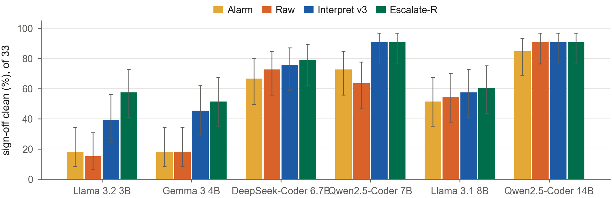

*Sign-off clean per model under Alarm, Raw, Interpret v3 and Escalate-R (33 runs per bar, Wilson 95% CI). Escalation
leads for every model, most on the two smallest.*

**Re-stated contrasts on sign-off clean** (was Table S20; six models; points, cell bootstrap 95% CI, sign-flip p, with
the loop-clean point estimate):

| A - B | Tasks | Delta | 95% CI | p | Loop-clean |
|---|---|---|---|---|---|
| Interpret v3 - Raw | all | +14.1 | +3.5 to +24.7 | 0.014 | +14.6 |
| | simulation-silent | +20.4 | +5.6 to +35.2 | 0.016 | +16.7 |
| | simulation-visible | +6.7 | -7.8 to +21.1 | 0.474 | +12.2 |
| Interpret v2 - Raw | all | +10.1 | +2.0 to +18.7 | 0.030 | +9.1 |
| Interpret v3 - Interpret v2 | all | +4.0 | -4.0 to +12.1 | 0.408 | +5.6 |
| Escalate-R - Interpret v3 | all | +5.1 | -2.0 to +12.6 | 0.255 | +6.1 |
| Escalate-R - Raw | all | +19.2 | +9.6 to +28.8 | <0.001 | +20.7 |
| Escalate-R - Baseline | simulation-visible | +14.4 | +3.3 to +27.8 | 0.048 | +23.3 |

**Cost per condition** (was Table S21; six models). Tool rounds: model calls whose prompt carried tool feedback.

| Condition | Calls per run | Tool rounds per run | Tokens per run | Tokens per sign-off clean | Clean by call 1, % |
|---|---|---|---|---|---|
| Baseline | 1.34 | 0.00 | 1,425 | 6,562 | 15 |
| Raw | 3.27 | 3.27 | 4,396 | 8,370 | 41 |
| Interpret v2 | 2.83 | 2.83 | 3,831 | 6,117 | 46 |
| Interpret v3 | 2.51 | 2.51 | 3,377 | **5,066** | **55** |
| Escalate-R | 2.99 | **1.32** | 3,798 | 5,295 | 42 |
| Alarm | 3.39 | 0.00 | 3,835 | 7,372 | 40 |

**Per model, v3 minus Raw:** +24.2 (Llama 3.2 3B, 13/33 against 5/33), +27.3 (Gemma 3 4B, 15/33 against 6/33), +3.0
(DeepSeek-Coder 6.7B, 25 against 24), +27.3 (Qwen2.5-Coder 7B, 30 against 21), +3.0 (Llama 3.1 8B, 19 against 18), 0
(Qwen2.5-Coder 14B, 30 each).

**Sign-off clean per task, of 18** (was Table S22; six models, three replicates; loop-clean in brackets where it
differs):

| Task | Baseline | Raw | v2 | v3 | Escalate-R | Alarm |
|---|---|---|---|---|---|---|
| *Simulation-silent* | | | | | | |
| `MuxPC` | 0 | 17 | 18 | 18 | 18 | 15 |
| `execute_mux` | 0 | 10 | 15 | 15 | 17 | 12 |
| `mem_wb_mux` | 0 | 9 [15] | 11 [14] | 11 [13] | 11 [16] | 9 [15] |
| `mux3` | 0 | 12 | 18 | 18 | 17 | 12 |
| `register_1bit` | 0 | 10 | 12 | 15 | 16 | 10 |
| `riscv_alu_flags` | 0 | 6 | 9 | 9 | 7 | 3 |
| *Simulation-visible* | | | | | | |
| `Address_select` | 0 [3] | 1 [8] | 1 [9] | 2 [14] | 4 [15] | 0 [2] |
| `register_32bit` | 15 | 11 | 12 | 15 | 16 | 14 |
| `register_4bit` | 14 | 10 | 11 | 14 | 17 | 15 |
| `noc_xbar4` | 10 | 9 | 10 | 9 | 9 | 9 |
| `ni_flit_pack` | 4 | 9 | 7 | 6 | 10 | 4 |

**Where v2 was silent or misleading** (was Table S23). Fired: runs with a directive on the defective input (of 18).
Clean: sign-off clean (of 18), loop-clean in brackets where it differs.

| Task | v2 on the input | v2 fired | v3 fired | v2 clean | v3 clean |
|---|---|---|---|---|---|
| `register_1bit` | silent (abort unhandled) | 0 | 18 | 12 | 15 |
| `ni_flit_pack` | silent (expression truncation) | 0 | 18 | 7 | 6 |
| `register_32bit` | gate on the clock (misleading) | 18 | 18 | 12 | 15 |
| `register_4bit` | gate on the clock (misleading) | 18 | 18 | 11 | 14 |
| `Address_select` | extra gating directive on a bus | 18 | 18 | 1 [9] | 2 [14] |

**Escalation.** 142/198 sign-off clean (72%), 1.32 tool rounds per run against 2.51 for always-on v3 (47.5% fewer). On
simulation-visible tasks DeepSeek-Coder 6.7B reaches 13/15 and Qwen2.5-Coder 7B 12/15 against Baseline's 9/15 each. 109
runs never escalated (100 ended sign-off clean); the 89 that did ended 42 sign-off clean.

**Composition** (was Table S24): top-level synthesis pass after splicing in each condition's repaired leaves (18 model
and replicate groups per cell, six models), and in brackets the groups that also reach the golden latch bound.

| Design | Baseline | Raw | v2 | v3 | Escalate-R | Alarm |
|---|---|---|---|---|---|---|
| 2x2 mesh | 0 [0] | 15 [10] | 13 [11] | 16 [15] | 18 [16] | 11 [8] |
| 3x3 mesh | 0 [0] | 15 [10] | 13 [11] | 16 [15] | 18 [16] | 11 [8] |
| MPSoC top | 0 [0] | 13 [8] | 12 [8] | 16 [14] | 15 [13] | 11 [1] |

For Qwen2.5-Coder 32B every tool condition composes 3/3 at the bound in all three designs, and Baseline 0/3.

**Oracle integrity: the equivalence audit** (was Table S25; all conditions of the 990 runs). Every clean repair was
checked against the golden fix with Yosys (`equiv_make`, `equiv_simple -seq 5`, `equiv_induct`), and its
constant-driven output bits were counted; each golden fix is equivalent to itself. No clean repair ties an output bit
to a constant beyond the golden fix. On `MuxPC`, `execute_mux`, `mux3`, `register_1bit` and `riscv_alu_flags` every
clean repair is equivalent, or equivalent on legal inputs. Class (i): differs from the golden fix on behaviour the
specification defines and the loop testbench does not check.

| Task | Clean runs | Equivalent | Equivalent on legal inputs | Class (i) |
|---|---|---|---|---|
| `Address_select` | 49 | 8 | 0 | 41 |
| `ni_flit_pack` | 36 | 36 | 0 | 0 |
| `noc_xbar4` | 47 | 0 | 47 | 0 |
| `register_32bit` | 69 | 69 | 0 | 0 |
| `register_4bit` | 66 | 66 | 0 | 0 |
| `mem_wb_mux` | 58 | 42 | 0 | 16 |

For each gap the sign-off testbench passes the golden fix, fails every class-(i) repair, still passes every other
clean repair, and fails a golden mutant that differs only in the unchecked cases.

**Gap runs and the production latch text** (was Table S26): loop-clean runs failing sign-off, six models, and how many
received the "`<safe value>` at the top of the block" text in any feedback round. A count, not a causal claim.

| | Baseline | Raw | v2 | v3 | Escalate-R | Alarm |
|---|---|---|---|---|---|---|
| `Address_select`: gap runs | 3 | 7 | 8 | 12 | 11 | 2 |
| with the advice | 0 | 0 | 8 | 12 | 11 | 0 |
| `mem_wb_mux`: gap runs | 0 | 6 | 3 | 2 | 5 | 6 |
| with the advice | 0 | 0 | 3 | 2 | 0 | 0 |

On `mem_wb_mux` the same advice also reached every v2 and v3 run that ended sign-off clean (11/11 each).

**Up the ladder, the details.** Every non-Baseline miss of the three commercial models is on `Address_select`, apart
from two Alarm runs on `riscv_alu_flags` for GPT-4.1 mini (and two for Qwen2.5-Coder 32B on the same ALU task);
Gemini 2.5 Flash's misses are Raw (3 of 3) and v3 (1 of 3). In the seven-model sensitivity pool (six models plus
Qwen2.5-Coder 32B) every contrast keeps its sign: Escalate-R minus Alarm +17.7 (CI +10.4 to +25.6), v3 minus Alarm
+13.4 (CI +3.5 to +23.8).

### I. Statistics and reproducibility (was S9)

Rates carry Wilson 95% intervals. Paired contrasts match runs on (model, task or module, replicate); runs are
independent draws, so the matching is a stratification. Because the replicates of a cell are correlated, general claims
use the mean over cells of the within-cell rate difference, with a cell bootstrap (10,000 resamples, percentile
interval) and a two-sided sign-flip permutation test over cells (20,000 random sign patterns, p = (1 + #{|d*| >= |d|})
/ 20,001), both seeded per label (seed 20260925 and the CRC of the label), so reruns reproduce byte for byte. The API
study's copy of these functions reproduces all twelve published small- and larger-model values exactly before any
contrast is reported. Per-model and per-task Phase 3 breakdowns use run-level McNemar tests with Holm correction within
each contrast. The deficit figure uses Newcombe intervals for a difference of two independent proportions. In Phase 3
the cell intervals are about 1.7 times wider than a per-run Wilson interval.

Every table and figure can be regenerated from the repository; the commands and the canonical evidence file for each
section are listed in `REPO_INDEX.md`.
